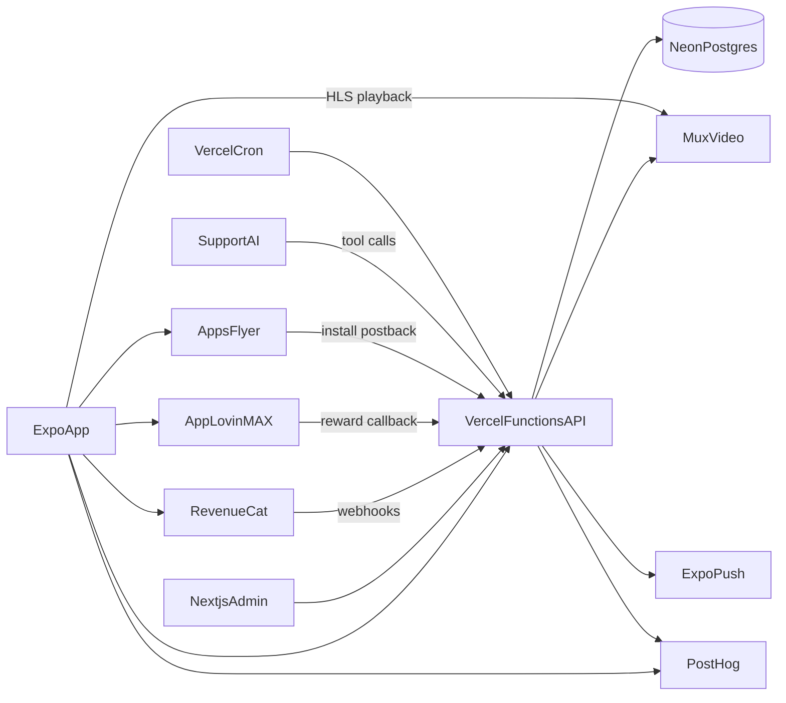
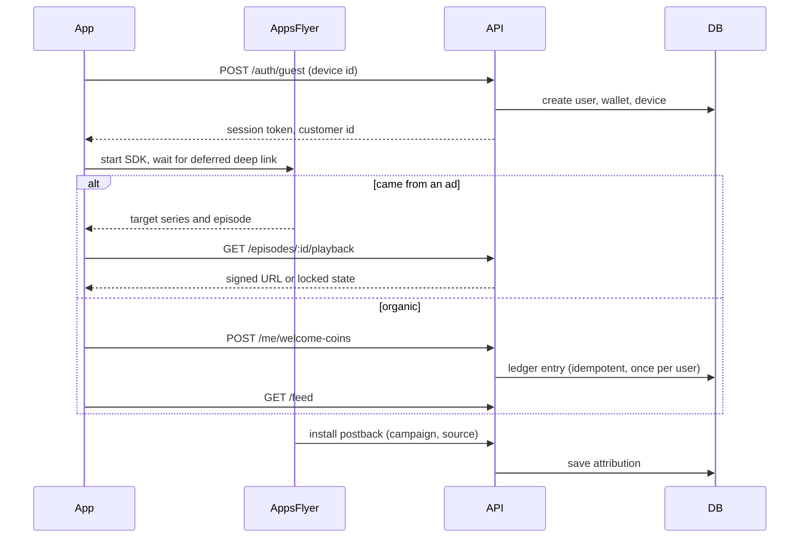
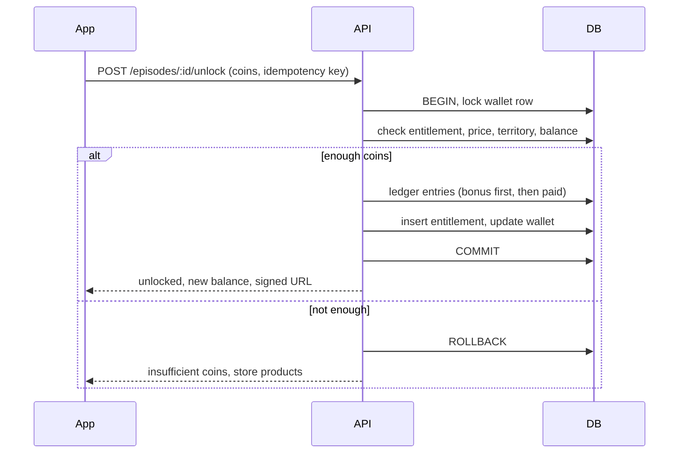
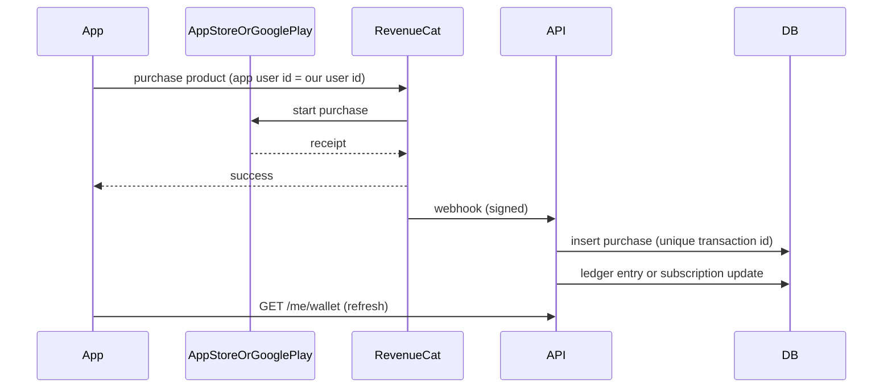
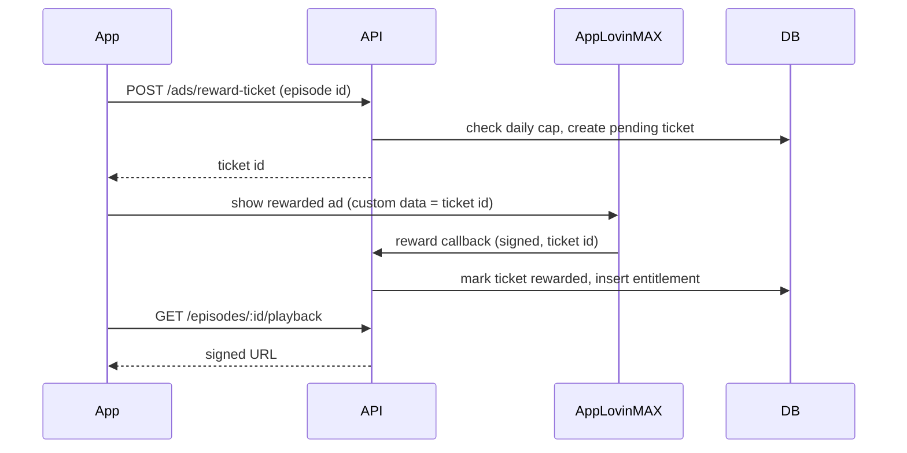
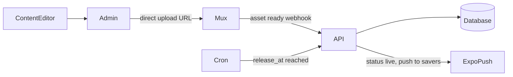

# DramaLama — Architecture and Backend Plan

Companion to [PRD.md](PRD.md). The PRD says _what_ we build. This document says _how_: which services we use, why, how the pieces talk to each other, and in what order we build them.

Each technical section starts with a short **In plain words** summary for readers who are not engineers.

## 1. Summary

**In plain words:** the app talks to one API that we own. The API runs on Vercel as small on-demand functions, so there are no servers to manage. All important data, especially coins, purchases, and unlocks, lives in one Postgres database hosted by Neon. The hard specialist problems (video streaming, app store payments, ads, install attribution) are handled by proven services that the leading short-drama apps also use.

| Layer                               | Choice                                                           | Why, in one line                                                                |
| ----------------------------------- | ---------------------------------------------------------------- | ------------------------------------------------------------------------------- |
| Mobile app                          | Expo (React Native), already built                               | Same family as ReelShort's app, one codebase for iOS and Android                |
| API                                 | TypeScript on **Vercel Functions** (Hono framework)              | No servers to run, scales automatically, same language as the app               |
| Database                            | **Postgres on Neon** (via Vercel Marketplace)                    | Money needs all-or-nothing transactions, and Postgres does that natively        |
| Database access                     | Drizzle ORM                                                      | Typed queries and migrations in TypeScript                                      |
| Accounts                            | Better Auth                                                      | Silent guest accounts, Apple, Google, email, and account linking                |
| Video                               | **Mux**                                                          | HLS with multiple bitrates, CDN, signed URLs, and DRM in one service            |
| Purchases and VIP                   | **RevenueCat**                                                   | Handles App Store and Google Play receipts, renewals, refunds, and restore      |
| Ads                                 | **AppLovin MAX** mediation (AdMob, Unity, Meta, Pangle)          | Industry standard in this category, maximizes ad revenue                        |
| Attribution and deferred deep links | **AppsFlyer**, plus Meta and TikTok SDKs                         | What all three main competitors use                                             |
| Push                                | expo-notifications + Expo Push Service                           | Built into Expo, one API for both platforms                                     |
| Analytics, feature flags, A/B tests | PostHog                                                          | Events, funnels, and remote config in one tool                                  |
| Search                              | Postgres full-text with trigram matching at MVP, Typesense later | Free to start, typo tolerance from day one, a dedicated engine if we outgrow it |
| Images (avatars, posters, banners)  | Vercel Blob behind a CDN                                         | Simple uploads from the app and the admin                                       |
| Crash and error monitoring          | Sentry                                                           | Crash reports for the app, error tracking for the API                           |
| Admin                               | Next.js on Vercel                                                | Same language and database as the API                                           |
| Scheduled jobs                      | Vercel Cron                                                      | Scheduled releases, license expiry, streak and mission resets                   |
| Companion                           | An existing support AI platform (Intercom Fin or Zendesk AI)     | PRD section 6.12 asks to integrate rather than build                            |

## 2. What the competitors use

**In plain words:** we looked inside ReelShort, DramaBox, and ShortMax using public SDK scans (lists of the third-party libraries shipped inside each app). Their choices confirm our direction and changed two parts of the plan: ads and install attribution.

Sources: [Tech Dev Notes (ReelShort)](https://techdevnotes.com/apps/ios/reelshort/1636235979/tech-stack), [AppGoblin (DramaBox)](https://appgoblin.info/apps/com.storymatrix.drama), [AppGoblin (ShortMax)](https://www.appgoblin.info/apps/live.shorttv.apps), and urlscan.io scans from 2026, plus industry write-ups on micro-drama monetization. These scans show which libraries are inside each app, not how their backends work internally.

|                                     | ReelShort                                                           | DramaBox                         | ShortMax                         |
| ----------------------------------- | ------------------------------------------------------------------- | -------------------------------- | -------------------------------- |
| App technology                      | React Native with native Swift parts                                | Not confirmed                    | Not confirmed                    |
| Video                               | Alibaba Cloud storage and player, Cloudflare and AWS CloudFront CDN | Not public                       | Not public                       |
| Attribution                         | AppsFlyer, Meta, TikTok                                             | AppsFlyer                        | AppsFlyer, Adjust                |
| Ads                                 | AppLovin, AdMob, Meta Audience Network, Pangle                      | AppLovin MAX, AdMob, Unity, Meta | AppLovin MAX, AdMob, Unity, Meta |
| Push, remote config, analytics      | Firebase                                                            | Firebase, SensorsData            | Firebase                         |
| Estimated revenue split (AppGoblin) | Not listed                                                          | 46–66% purchases, 34–54% ads     | 42–65% purchases, 35–58% ads     |

What we learn:

- **React Native is good enough for this category.** The market leader ships its app on it.
- **Ads are a major revenue line, not a side feature.** Between a third and more than half of revenue comes from ads. That is why we plan ad mediation from day one instead of a single ad network.
- **Paid acquisition runs on Meta and TikTok.** AppsFlyer and the Meta and TikTok SDKs are what make "open the episode from the ad" (PRD flow UC-1) work and let us measure which campaigns pay back.
- **Firebase is used on the device, not as the money database.** Competitors use it for push, analytics, and remote config. Their coin balances and unlocks live in their own backends.
- **The money backend looks the same everywhere:** a coin ledger with separate paid and bonus balances, an entitlement service, server-side verification of every purchase and every ad reward, protection against duplicate callbacks, refund reversals, and server-side daily caps. All of it runs inside database transactions.
- **They own their video storage and CDN** because video delivery is their largest cost at scale. We start with Mux for speed and keep a path to cheaper delivery (section 10).
- **ReelShort runs web landing pages for its ads** (Next.js). A web checkout from those pages avoids store fees. We list it as a later phase.

What we do differently, following the PRD: a taste profile from the first session, points and missions, a companion that handles support, and episode comments.

## 3. Backend options considered

**In plain words:** there are several ways to build the backend. We compared five on what matters most for this app: keeping money safe, speed to build with a small team, cost, and how hard it would be to switch later.

### 3.1 The options

**A. Vercel Functions + Neon Postgres (recommended)**
Our own TypeScript API on Vercel, with a managed Postgres database from Neon. Vercel lists Neon as its built-in Postgres option, so setup is a few clicks and billing is in one place.

- Pros: full control of the money logic, standard SQL with no lock-in, generous free tiers, the admin can live on the same platform, and functions scale to zero when idle.
- Cons: we write auth wiring, the API, and the admin ourselves (with libraries).

**B. Vercel Functions + a document database (MongoDB Atlas)**
The same API, with a non-relational database that stores flexible JSON documents.

- Pros: flexible schema, familiar to many developers.
- Cons: the coin ledger, entitlements, and reports are relational by nature (users, episodes, purchases, unlocks all point at each other). Multi-document transactions exist but are an add-on, not the default way of working. Reports such as "revenue per series per territory" are harder.

**C. Supabase (Postgres + Auth + Storage + Edge Functions)**
An all-in-one platform built on Postgres.

- Pros: fastest start, auth and admin table editor included, still real Postgres underneath.
- Cons: business logic is split between database policies and edge functions, which is harder to reason about for money flows. Leaving the platform later means rewriting auth and functions.

**D. Firebase (Firestore + Auth + Cloud Functions)**
Google's all-in-one platform with a document database.

- Pros: very fast to prototype, great client SDKs, competitors already use Firebase for push and analytics.
- Cons: Firestore is a poor fit for a ledger and for reporting. Costs grow per read, and a vertical feed reads a lot. Strong lock-in, because data model, security rules, and functions are all Firebase-specific.

**E. Expo API Routes on EAS Hosting**
API endpoints written inside the Expo project itself and deployed with EAS.

- Pros: one project, one deploy tool.
- Cons: young product, fewer integrations, and the admin would still live elsewhere. Better suited to light endpoints than to a full backend with webhooks and scheduled jobs.

### 3.2 Comparison

Scores from 1 (weak) to 5 (strong).

| Criterion                       | A. Vercel + Neon | B. Vercel + MongoDB | C. Supabase | D. Firebase | E. EAS API Routes |
| ------------------------------- | ---------------- | ------------------- | ----------- | ----------- | ----------------- |
| Money safety (ledger, unlocks)  | 5                | 3                   | 5           | 2           | 4                 |
| Speed to first version          | 4                | 4                   | 5           | 5           | 3                 |
| Cost at MVP                     | 5                | 4                   | 5           | 5           | 4                 |
| Cost at scale                   | 4                | 3                   | 4           | 2           | 3                 |
| Reporting and analytics queries | 5                | 3                   | 5           | 2           | 4                 |
| Freedom to switch later         | 5                | 4                   | 3           | 1           | 3                 |
| Fit for the admin               | 5                | 4                   | 4           | 3           | 2                 |
| Maturity and integrations       | 5                | 5                   | 4           | 5           | 2                 |

**Recommendation: option A.** It scores well everywhere and has no weak spot. Supabase (C) is a close second and a reasonable alternative if we want auth and a table editor out of the box. In both cases the database is Postgres, so the data model in section 6 stays the same.

## 4. Why a relational database (Postgres)

**In plain words:** most of the important things in this app are money. When a viewer unlocks an episode, two things must happen together: coins are deducted and the episode is unlocked. If only one happens, the viewer either loses coins or gets content for free. A relational database like Postgres guarantees "both or neither" by design. This is called a transaction.

Concerns about Postgres, answered:

- **"I don't want to run a database server."** We don't. Neon is fully managed: no servers, automatic backups, and it pauses when idle so it costs nothing at night in development.
- **"Isn't it old or complicated?"** It is the most widely used open-source database and the default choice of Vercel, Supabase, and most startups. Because it is standard, any developer can work on it and we can move to another host without rewriting.
- **"Is it fast enough for a video app?"** The database does not serve video. Video comes from the Mux CDN. The database answers small questions (what is on Home, is this episode unlocked), and frequently read data like the catalog is cached.
- **"What about flexible data?"** Postgres also stores JSON. We use it for things like taste quiz answers and companion metadata.

Concrete guarantees we rely on:

- Unlocking with coins, granting VIP, and crediting an ad reward each run in one transaction.
- A unique "idempotency key" on every ledger entry, so a payment or ad callback that arrives twice is only counted once.
- Row locking on the wallet during a spend, so two quick taps cannot spend the same coins twice.
- Foreign keys, so an unlock can never point at an episode that does not exist.

## 5. System overview

**In plain words:** the app never decides on its own whether a viewer may watch a locked episode or how many coins they have. It always asks the API. Stores, ad networks, and video services report back to the API directly, so the result cannot be faked from the phone.



### 5.1 Components

| Component          | Responsibility                                                                                                                                             |
| ------------------ | ---------------------------------------------------------------------------------------------------------------------------------------------------------- |
| Mobile app         | UI, playback, local cache of catalog and progress, sends events. Never trusted for money or entitlements.                                                  |
| API                | Catalog, feed, accounts, progress sync, wallet, unlocks, comments, gamification, personalization, webhooks.                                                |
| Database           | Source of truth for everything except video files and analytics events.                                                                                    |
| Mux                | Stores source videos, transcodes to HLS renditions, makes thumbnails, serves through its CDN with signed URLs.                                             |
| RevenueCat         | Talks to App Store and Google Play, validates receipts, tracks renewals and refunds, notifies the API.                                                     |
| AppLovin MAX       | Picks the best-paying rewarded ad across networks and calls the API when a viewer finishes an ad.                                                          |
| AppsFlyer          | Tells the app which ad led to the install, so the app can open that episode (deferred deep link).                                                          |
| Expo Push          | Delivers push notifications to iOS and Android from one API.                                                                                               |
| PostHog            | Product analytics, funnels, retention, feature flags, and A/B tests.                                                                                       |
| Admin              | Content, pricing, territories, licenses, home rows, collections, missions, moderation, push campaigns. Roles: admin, content editor, moderator, read-only. |
| Companion platform | Chat UI and AI agent. Calls our API through limited tools (read wallet, read purchases, trigger restore, escalate).                                        |

### 5.2 Repository layout

The app stays at the repo root. New folders are added next to it:

```
/                 Expo app (existing: app/, components/, context/, lib/, data/)
/server           API: Hono routes, Drizzle schema, migrations, seed, webhooks, cron
/admin            Next.js admin (phase M2)
```

Shared request and response types live in `/server` and are imported by the app and the admin, so all three agree on the shape of the data.

## 6. Data model

**In plain words:** these are the tables in the database and what each one holds. The most important group is "money": every coin or point that moves is written down as a line in a ledger, like a bank statement, and the balance is the sum of those lines.

### 6.1 Accounts

| Table             | Key fields                                                                                                                                                                                         |
| ----------------- | -------------------------------------------------------------------------------------------------------------------------------------------------------------------------------------------------- |
| `users`           | id, customer_id (short, human readable), display_name, email, avatar_url, is_guest, country, time_zone, age_confirmed, mature_filter, auto_unlock, personalization_opt_out, created_at, deleted_at |
| `admin_users`     | id, email, role (admin, content_editor, moderator, read_only)                                                                                                                                      |
| `auth_identities` | user_id, provider (anonymous, apple, google, email), provider_user_id                                                                                                                              |
| `devices`         | id, user_id, platform, app_version, push_token, att_status, last_seen_at                                                                                                                           |
| `attributions`    | user_id, source (organic, paid), media_source, campaign, target_series_id, target_episode_id, raw                                                                                                  |

### 6.2 Catalog and licensing

| Table                              | Key fields                                                                                                                                                                                                                           |
| ---------------------------------- | ------------------------------------------------------------------------------------------------------------------------------------------------------------------------------------------------------------------------------------ |
| `series`                           | id, slug, title, tagline, synopsis, poster_url, banner_url, genre_id, badge (hot, new, exclusive), rating, content_rating, free_episode_count, coin_price, view_count, credits, status (draft, scheduled, live, retired), release_at |
| `seasons`                          | id, series_id, number, title (optional per PRD)                                                                                                                                                                                      |
| `episodes`                         | id, series_id, season_id, number, title, duration_sec, mux_asset_id, mux_playback_id, subtitle_tracks (language list, files stored as Mux text tracks), coin_price_override, release_at                                              |
| `genres`, `tags`, `series_tags`    | genre and trope lists, and the many-to-many link to series                                                                                                                                                                           |
| `licenses`                         | series_id, licensor, starts_at, ends_at, allows_ads, allows_paid_unlocks, revenue_share_notes                                                                                                                                        |
| `license_territories`              | license_id, country_code                                                                                                                                                                                                             |
| `collections`, `collection_series` | editorial or rule-based collections, rule (JSON), schedule, territories                                                                                                                                                              |
| `home_rows`                        | position, type (hero, trending, new, genre, collection, recommended), ref_id, territories, active window                                                                                                                             |
| `popular_searches`                 | term, position                                                                                                                                                                                                                       |

### 6.3 Viewing and engagement

| Table                              | Key fields                                                                                                |
| ---------------------------------- | --------------------------------------------------------------------------------------------------------- |
| `watch_progress`                   | user_id, series_id, episode_id, position_sec, completed, updated_at                                       |
| `saves`, `likes`                   | user_id, series_id or episode_id, created_at                                                              |
| `comments`                         | id, episode_id, user_id, parent_id (one reply level), text, like_count, status (visible, hidden, deleted) |
| `comment_likes`, `comment_reports` | user_id, comment_id, reason                                                                               |
| `user_blocks`                      | user_id, blocked_user_id (the viewer no longer sees that user's comments)                                 |
| `user_moderation`                  | user_id, state (muted, banned), until                                                                     |

### 6.4 Money

| Table            | Key fields                                                                                                                                                                                                                                          |
| ---------------- | --------------------------------------------------------------------------------------------------------------------------------------------------------------------------------------------------------------------------------------------------- |
| `wallets`        | user_id, paid_coins, bonus_coins, points (cached balances, always equal to the sum of the ledger)                                                                                                                                                   |
| `ledger_entries` | id, user_id, currency (coins_paid, coins_bonus, points), amount (positive or negative), reason (purchase, unlock, welcome, checkin, mission, comment, ad, refund, admin), ref_type, ref_id, idempotency_key (unique), reverses_entry_id, created_at |
| `entitlements`   | user_id, episode_id, source (coins, ad, vip, free, admin), ledger_entry_id, created_at. Unique on (user_id, episode_id).                                                                                                                            |
| `purchases`      | id, user_id, store, product_id, store_transaction_id (unique), type (coin_pack, points_pack, subscription), status, amount, currency, raw                                                                                                           |
| `subscriptions`  | user_id, product_id, status, period_end, will_renew, store                                                                                                                                                                                          |
| `ad_rewards`     | id, user_id, episode_id, network, ad_transaction_id (unique), status, created_at                                                                                                                                                                    |
| `products`       | id, store_product_id, type, coins, bonus_coins, points, first_purchase_bonus                                                                                                                                                                        |

Rules:

- Bonus coins are spent before paid coins. Refunds claw back paid coins first.
- Balances are only changed by writing ledger entries, never edited directly.
- VIP is checked from `subscriptions` at request time and does not create per-episode entitlements.

### 6.5 Gamification and personalization

| Table                 | Key fields                                                                                                                            |
| --------------------- | ------------------------------------------------------------------------------------------------------------------------------------- |
| `checkins`            | user_id, device_id, local_date, streak, coins_granted (bonus coins, written to the ledger)                                            |
| `missions`            | id, title, goal_type (episodes_completed, series_started, comments), goal_count, period (daily, weekly), reward_points, active window |
| `mission_progress`    | user_id, mission_id, period_key, progress, completed_at                                                                               |
| `daily_caps`          | user_id, action, local_date, count                                                                                                    |
| `taste_profiles`      | user_id, quiz_answers (JSON), genre_weights (JSON), tag_weights (JSON), updated_at                                                    |
| `push_campaigns`      | id, segment, title, body, deep_link, scheduled_at, sent_at                                                                            |
| `support_escalations` | id, user_id, platform_conversation_id, status                                                                                         |

## 7. API

**In plain words:** these are the "doors" into the backend that the app and the admin knock on. Each one does one job and checks who is asking.

All endpoints are JSON over HTTPS. The app sends a session token in the `Authorization` header. Webhooks are verified by signature. Admin endpoints require an admin role.

| Area            | Endpoints                                                                                                                                                                                   |
| --------------- | ------------------------------------------------------------------------------------------------------------------------------------------------------------------------------------------- |
| Auth            | `POST /auth/guest`, `POST /auth/link` (Apple, Google, email), `POST /auth/sign-out`, `DELETE /me`                                                                                           |
| Catalog         | `GET /home`, `GET /feed?cursor=`, `GET /series/:id`, `GET /series/:id/episodes`, `GET /categories`, `GET /categories/:id?sort=&tags=`, `GET /search?q=&tags=&genre=`, `GET /search/popular` |
| Playback        | `GET /episodes/:id/playback` (returns a signed HLS URL, or a locked state with prices)                                                                                                      |
| Library sync    | `GET /me/progress`, `PUT /me/progress`, `GET /me/saves`, `PUT /me/saves/:seriesId`, `PUT /me/likes/:id`                                                                                     |
| Profile         | `GET /me`, `PATCH /me`, `POST /me/avatar` (upload URL), `GET /me/wallet`, `GET /me/transactions?cursor=`                                                                                    |
| Unlock          | `POST /episodes/:id/unlock` with `{ method: "coins" }` and an idempotency key, `POST /ads/reward-ticket`                                                                                    |
| Store           | `GET /store/products`, `POST /store/restore`                                                                                                                                                |
| Webhooks        | `POST /webhooks/revenuecat`, `POST /webhooks/applovin-reward`, `POST /webhooks/appsflyer`, `POST /webhooks/mux`, `POST /webhooks/support` (human agent replied, triggers a push)            |
| Comments        | `GET /episodes/:id/comments?sort=`, `POST /episodes/:id/comments`, `POST /comments/:id/like`, `POST /comments/:id/report`, `POST /users/:id/block`                                          |
| Gamification    | `POST /me/welcome-coins`, `POST /me/checkin`, `GET /me/missions`, `GET /me/points-history`                                                                                                  |
| Personalization | `GET /quiz`, `PUT /me/taste`, `DELETE /me/taste`                                                                                                                                            |
| Push            | `PUT /me/push-token`, `PATCH /me/notification-settings`                                                                                                                                     |
| Companion tools | `GET /companion/context`, `POST /companion/restore`, `POST /companion/escalate` (called by the companion platform with a server key, scoped to one user)                                    |
| Admin           | CRUD for series, episodes, licenses, collections, home rows, missions, products, popular searches; upload URLs for Mux; moderation queue; push campaigns; reports                           |
| Cron            | `/cron/releases` (every 5 minutes), `/cron/licenses` (hourly), `/cron/push-campaigns` (every 5 minutes), `/cron/reminders` (hourly)                                                         |

Territory: every catalog and playback request checks the viewer's country (from Vercel's request geo header, falling back to the stored account country) against the series license territories and window.

## 8. Key flows

### 8.1 First open (PRD UC-1)



Welcome coins are only granted when the server has no paid attribution for the user. The app waits a short time for AppsFlyer before deciding, and the server makes the final call.

### 8.2 Unlock with coins (PRD UC-2)



Auto-unlock uses the same endpoint, called by the app when auto-advance reaches a locked episode and the setting is on.

### 8.3 Purchase (coins, points, or VIP)



The balance updates only after the webhook arrives (PRD US-17). The app shows "processing" for a few seconds and polls the wallet. Refunds and cancellations arrive through the same webhook and write reversing entries.

### 8.4 Rewarded ad unlock



The episode unlocks only when the ad network confirms the reward to the server. A callback that arrives twice for the same ticket is ignored.

### 8.5 Publish a series (PRD flow 5)



## 9. Security, privacy, and compliance

- **The server grants everything.** Coins, points, entitlements, VIP, and caps are decided on the server. The app only displays results.
- **Signed video URLs.** Locked episodes get a short-lived signed Mux playback URL only after the entitlement check. DRM (FairPlay and Widevine) can be switched on per series if a licensor requires it.
- **Webhooks are verified** by signature or shared secret before anything is written.
- **Idempotency** on every money-moving request and webhook.
- **Rate limits** on auth, unlock, comments, and check-in, to stop scripts and abuse.
- **Daily caps** for points and ad unlocks are enforced on the server in the viewer's time zone.
- **Coin farming protection:** welcome coins and daily check-in coins are limited per device as well as per account, so creating new guest accounts on the same phone does not earn more coins.
- **Account deletion** (`DELETE /me`) removes personal data and keeps anonymized financial records as the law requires.
- **Consent:** App Tracking Transparency on iOS before AppsFlyer or ad tracking identifiers are used, a consent screen (Google UMP) for GDPR regions, and a personalization opt-out stored on the user.
- **Companion access** is limited to one user per call, read-only except for restore and escalate, and never makes purchases.
- **Secrets** live in Vercel environment variables, separate for development, preview, and production.

## 10. Environments and cost

### 10.1 Environments

| Environment | API                                  | Database                | App                                             |
| ----------- | ------------------------------------ | ----------------------- | ----------------------------------------------- |
| Local       | `vercel dev` or Hono dev server      | Neon development branch | Expo dev build pointing at local or preview API |
| Preview     | Vercel preview deployment per branch | Neon branch per preview | EAS development build                           |
| Production  | Vercel production                    | Neon main branch        | Store builds, OTA updates with EAS Update       |

Neon branches are instant copies of the database, so every preview can test migrations against real-looking data without touching production.

Note: RevenueCat, AppLovin MAX, and AppsFlyer include native code, so they need an Expo development build. They do not run in Expo Go.

### 10.2 Rough monthly cost

**In plain words:** almost everything is free or cheap at the start. The one cost that grows fast is video delivery, because every minute watched is data sent over the network. Prices below are rough and must be checked against current price lists before committing.

| Service      | Pricing model                                                        | At launch (about 1K monthly users) | At 100K monthly users        |
| ------------ | -------------------------------------------------------------------- | ---------------------------------- | ---------------------------- |
| Vercel       | Pro plan per seat, plus usage                                        | About $20                          | $50–300                      |
| Neon         | Free tier, then usage-based                                          | $0–20                              | $70–300                      |
| Mux          | Per minute stored and per minute delivered                           | Under $100                         | Largest cost line, see below |
| RevenueCat   | Free up to a revenue threshold, then a percentage of tracked revenue | $0                                 | About 1% of store revenue    |
| AppLovin MAX | No mediation fee, ad networks pay us                                 | $0                                 | $0                           |
| Sentry       | Free tier, then plan                                                 | $0                                 | $26–100                      |
| AppsFlyer    | Free starter tier, then contract                                     | $0                                 | Contract, varies             |
| PostHog      | Generous free event tier, then usage-based                           | $0                                 | $0–500                       |
| Expo (EAS)   | Free tier, then plan                                                 | $0–19                              | About $199                   |

Video estimate at 100K monthly users: if each viewer watches about 160 minutes a month (10 sessions × 8 episodes × 2 minutes), that is about 16 million minutes delivered per month. At roughly $0.001 per delivered minute that is in the range of $10–20K per month, depending on resolution and negotiated rates. Competitors own their storage and CDN for this reason. Our path when video cost becomes significant:

1. Negotiate volume pricing with Mux and cap resolution at 720p for vertical phone video.
2. Move delivery to Cloudflare Stream, or to our own HLS files on Cloudflare R2 (no egress fees) or S3 with a CDN.

Because episodes reference playback IDs through our API, this switch does not require an app update.

## 11. App changes

**In plain words:** the screens stay as they are. What changes is where their data comes from: from the API instead of the file bundled inside the app.

- **API client** in `lib/api.ts`, base URL from `EXPO_PUBLIC_API_URL`, session token stored securely on the device.
- **Data fetching and caching** with TanStack Query, so screens show cached data instantly and refresh in the background. This keeps the "first frame in 2 seconds" goal from the PRD.
- `data/catalog.ts` becomes the seed for the database and is no longer imported by screens.
- `context/Playback.tsx` keeps a local copy for instant resume and offline use, and syncs progress, saves, and likes with the API.
- `context/Wallet.tsx` becomes read-only on the device: balances come from `GET /me/wallet`, and every change goes through the API.
- **Playback** asks `GET /episodes/:id/playback` for each episode, and the player prefetches the next one.
- **New native SDKs** (phase M1 and later): RevenueCat, AppLovin MAX, AppsFlyer, PostHog, expo-notifications. Each is added with `npx expo install` and its Expo config plugin.

## 12. Phasing

Maps the PRD phases (PRD section 13) to backend work. Basic server search moves to M0 because the app already has search and the bundled catalog it searches is replaced in M0. Personalized search ranking stays in M3 as in the PRD.

| Phase                  | Backend and infrastructure work                                                                                                                                                                                                                                                                         |
| ---------------------- | ------------------------------------------------------------------------------------------------------------------------------------------------------------------------------------------------------------------------------------------------------------------------------------------------------- |
| M0 — foundation        | Vercel project, Neon database, Drizzle schema and migrations, seed from `data/catalog.ts`, guest auth, catalog, feed, series, categories, search (Postgres full-text and trigram), progress, saves, likes. App switched to the API. Mux for episode playback. Sentry in the app and the API.            |
| M1 — monetization      | Wallet and ledger, entitlements, unlock endpoint, RevenueCat products and webhooks, VIP, restore, Profile endpoints (wallet, transactions, customer ID, settings), comments with profanity filter, account linking (Apple, Google, email), account deletion.                                            |
| M2 — operations        | Next.js admin with roles, Mux upload pipeline, scheduling and cron, licenses and territories, home rows and collections, comment moderation queue.                                                                                                                                                      |
| M3 — growth            | Expo push and campaigns, AppLovin MAX rewarded ads with server reward verification, AppsFlyer attribution and deferred deep links, welcome coins, check-in, missions and caps, taste quiz and profile, personalized Home and search boost, PostHog dashboards and feature flags, companion integration. |
| Launch                 | Production hardening, load test of feed and unlock, monitoring and alerts, soft launch in 1–2 territories.                                                                                                                                                                                              |
| M4 — companion economy | Skins catalog and points spending, avatar editor storage. Optional: Typesense search, web checkout from ad landing pages, move video delivery to own CDN.                                                                                                                                               |

## 13. Open decisions

| Decision                    | Options                                          | Recommended default                                          |
| --------------------------- | ------------------------------------------------ | ------------------------------------------------------------ |
| Backend platform            | Vercel + Neon, or Supabase                       | Vercel + Neon                                                |
| Auth library                | Better Auth, Clerk, or Supabase Auth             | Better Auth (no per-user fees, works with our own database)  |
| Companion platform          | Intercom Fin, Zendesk AI, or a custom LLM agent  | Decide in M3 after comparing price per resolution            |
| DRM                         | Signed URLs only, or full DRM                    | Signed URLs, switch on DRM per licensor requirement          |
| Analytics                   | PostHog only, or PostHog plus Firebase Analytics | PostHog only, add Firebase only if an ad partner requires it |
| Second attribution provider | AppsFlyer only, or also Adjust                   | AppsFlyer only                                               |
