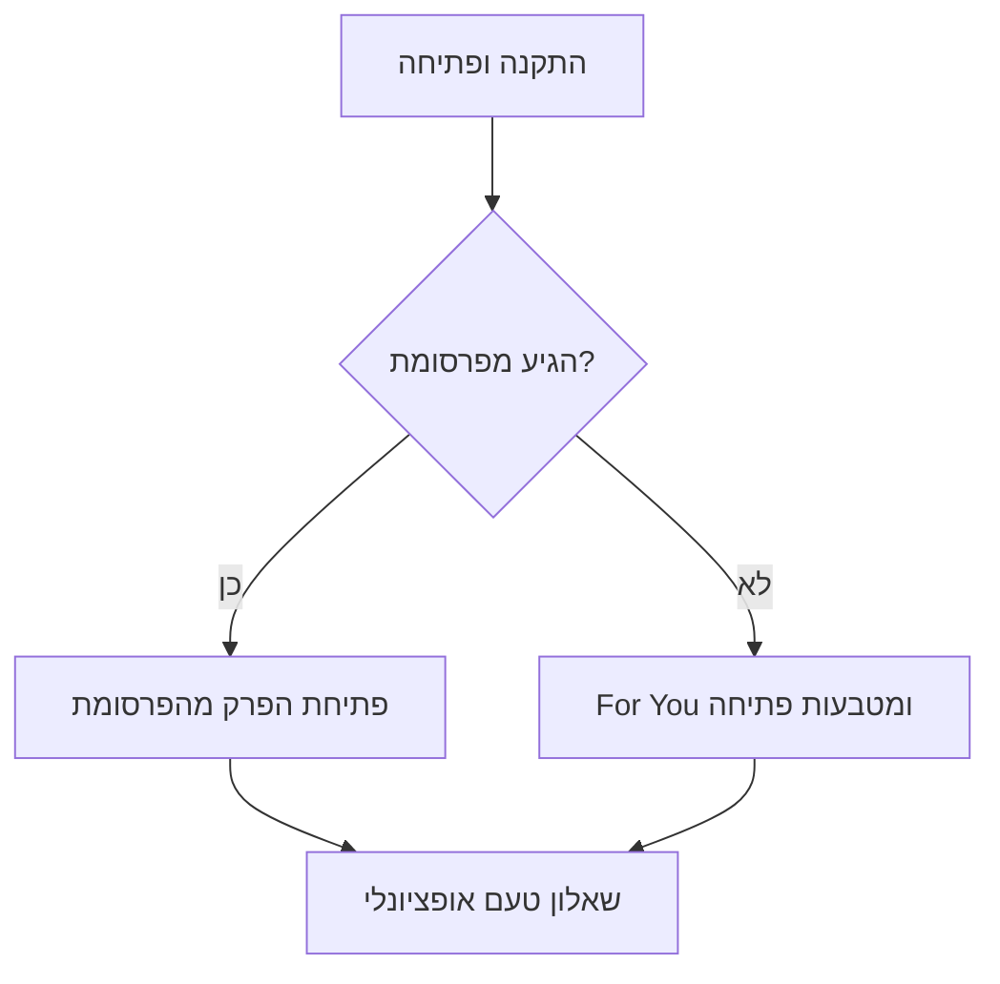

# DramaLama — מסמך דרישות מוצר (PRD)

> עותק בעברית לקריאה בלבד. המסמך המחייב הוא [PRD.md](PRD.md) באנגלית.

## 1. תקציר

DramaLama היא אפליקציית מובייל לסדרות דרמה אנכיות עם פרקים קצרים (1–3 דקות לפרק, 20–100 פרקים לסדרה). הצופים מחליקים בין פרקים במסך מלא. הפרקים הראשונים של כל סדרה חינמיים, ואת השאר פותחים עם מטבעות, מנוי VIP או צפייה בפרסומת מתגמלת.

שוק ההשקה בינלאומי, באנגלית קודם כול. התוכן מגיע ברישיון מיצרנים ומפיצים קיימים של דרמות קצרות.

## 2. רקע ובעיה

### הבעיה

- צופים רוצים סיפורים סוחפים שנכנסים בכמה דקות פנויות: בדרך לעבודה, בהפסקה או לפני השינה. סטרימינג רגיל בנוי לפרקים של 45 דקות מול טלוויזיה, לא לצפייה ביד אחת בטלפון.
- אפליקציות הדרמות הקצרות הקיימות פתרו את הפורמט, אבל רובן מרגישות אותו דבר: חלונות תשלום אגרסיביים, גילוי תוכן גנרי שמתעלם ממה שהצופה אוהב, ומעט סיבות לחזור אחרי שסדרה נגמרת.
- התמיכה באפליקציות האלה היא בדרך כלל טופס אימייל, כך שבעיות בתשלום ובפתיחת פרקים הופכות לנטישה ולביקורות רעות.

### ההזדמנות

- דרמה קצרה אנכית היא קטגוריה שצומחת מהר, בהובלת אפליקציות של אולפנים מסין שמתרחבים לשווקים דוברי אנגלית. הפורמט הוכיח שצופים מוכנים לשלם לפי פרק על סיפורים שבנויים על רגעי שיא.
- יש תוכן זמין לרישוי מיצרנים ומפיצים קיימים, כך שאפשר להשיק בלי הפקות מקור.

### מתחרים

| אפליקציה | מה היא עושה טוב | הפער שאנחנו מכוונים אליו |
| --- | --- | --- |
| ReelShort | קטלוג מקורי ומותג חזקים, מיקום יעיל של חלון התשלום | מעט התאמה אישית ומעט סיבות להישאר אחרי שסדרה נגמרת |
| DramaBox | קטלוג גדול, הרבה סדרות חדשות | גילוי תוכן גנרי, מונטיזציה כבדה על מטבעות |
| ShortMax ואפליקציות דומות | קטלוגים שמעתיקים מהר, מבצעים אגרסיביים | חוויה דומה בין האפליקציות, קהילה ותמיכה חלשות |

### במה DramaLama שונה

- **גילוי תוכן מותאם אישית:** פרופיל טעם מניע את מסך הבית, החיפוש וההמלצות כבר מהסשן הראשון.
- **סיבות לחזור:** נקודות, רצפי ימים ומשימות מתגמלים צפייה יומית והשתתפות.
- **קומפניון ולא מרכז עזרה:** דמות בתוך האפליקציה ממליצה על סדרות, עונה על שאלות תמיכה ומעבירה לנציג אנושי כשצריך.
- **קהילה סביב הפרקים:** תגובות בכל פרק הופכות רגעי שיא לשיחה.

## 3. מטרות ומה לא נכלל

### מטרות

- הפרק הראשון מתחיל לרוץ תוך 2 שניות מפתיחת סדרה או פיד ה-For You.
- להשאיר את הצופים בתוך הסדרה עם מעבר אוטומטי לפרק הבא, חלון תשלום ברגעי שיא (cliffhanger), והמשך צפייה מכל מקום.
- לייצר הכנסות במודל היברידי בלי לחסום את גילוי התוכן.
- לתת לצוות התוכן ממשק ניהול עצמאי לפרסום סדרות מורשות בלי עזרה של מפתחים.
- התאמה אישית של גילוי התוכן: מסך הבית, החיפוש וההמלצות מותאמים למה שכל צופה אוהב.
- שימור צופים לטווח ארוך יותר מסדרה אחת, בעזרת גיימיפיקציה (נקודות, רצפי ימים, משימות) וקומפניון בתוך האפליקציה.

### מה לא נכלל ב-MVP

- תוכן שמשתמשים מעלים או העלאות של יוצרים (תגובות לפרקים הן תוכן המשתמשים היחיד שנכלל).
- הפקות מקור.
- פרופילים חברתיים, מעקב אחרי משתמשים או הודעות פרטיות בין צופים.
- הורדות לצפייה אופליין.
- שפות מלבד אנגלית (הממשק צריך להיות מוכן לתרגום).

## 4. קהל יעד

- **ראשי:** גילאי 25–45, בעיקר נשים, צופות במובייל בלבד, בסשנים קצרים (בדרך לעבודה, בהפסקות, לפני השינה), ואוהבות רומנטיקה, נקמה, סיפורי מנכ"ל ואנשי זאב.
- **משני:** צופי בינג' שמסיימים סדרה בישיבה אחת או שתיים, והם עיקר המשלמים.
- שתי הקבוצות פתוחות למשחקיות קלה: הן מגיבות לתגמולים יומיים, רצפי ימים ופריטי אספנות, ועל זה נשענים הגיימיפיקציה והקומפניון.

## 5. מה קיים היום (אב-טיפוס)

נבנה ב-Expo SDK 58 עם Expo Router:

- **מסך הבית:** באנר ראשי מתחלף, המשך צפייה, טופ 10 טרנדי, חדש ובלעדי, רשת ז'אנרים.
- **For You:** פיד אנכי להחלקה שמנגן אוטומטית את פרק 1 של כל סדרה.
- **נגן:** פיד פרקים אנכי במסך מלא, מעבר אוטומטי לפרק הבא, מהירות ניגון, חלון בחירת פרקים, וסרגל לייק / שמירה / שיתוף / תגובות. כפתור Episodes פותח את חלון הפרקים גם בנגן וגם ב-For You.
- **עמוד סדרה:** נתונים, תגיות, תקציר נפתח, ורשת פרקים ממוספרת עם סימון של פרקים שנצפו והפרק הנוכחי.
- **טאב ספרייה:** המשך צפייה עם התקדמות, והרשימה שלי (סדרות שמורות).
- **טאב פרופיל:** מזהה לקוח עם כפתור העתקה, יתרת מטבעות ונקודות, סטטוס VIP, כניסה יומית עם רצף של 7 ימים, משימות לדוגמה, וכניסה לחנות ולתמיכה. התחברות, העדפות, עדכון פרטים והגדרות הם עדיין מסכים זמניים.
- **חנות:** חבילות מטבעות, תוכניות VIP וחבילות נקודות עם מחירים לדוגמה. עדיין אין רכישות אמיתיות.
- **תגובות לפרקים:** חלון תגובות מעל הווידאו שממשיך לרוץ, עם מסנן קללות ונקודות על כתיבת תגובות עד מגבלה יומית. התגובות הן נתוני דוגמה.
- **קומפניון:** כפתור צף במסך הבית, בספרייה ובפרופיל, וצ'אט עם תשובות מוכנות מראש להמלצות ולשאלות תמיכה נפוצות.
- **נתונים:** קטלוג ותגובות קשיחים בקוד, פוסטרים ווידאו לדוגמה. התקדמות, שמירות, לייקים, מטבעות ונקודות נשמרים במכשיר בלבד.

הממשק באנגלית ומשמאל לימין. חיפוש וקטגוריות בצד הלקוח (סעיף 6.6) כבר קיימים.

**הפער ל-MVP:** אין עדיין שרת, חשבונות, חלון תשלום ופרקים נעולים, רכישות אמיתיות, ממשק ניהול או התראות פוש, והחיפוש רץ רק על הקטלוג שבתוך האפליקציה. עדיין לא נבנו: שאלון הטעם וההתאמה האישית, פתיחה ראשונה לפי מקור ההגעה מפרסומת, העברה אמיתית לנציג תמיכה, ואימות בשרת של מטבעות ונקודות.

## 6. היקף ה-MVP

### 6.1 קטלוג ושרת

- סדרות, עונות (אופציונלי), פרקים, ז'אנרים, תגיות, תוויות ודירוגים מגיעים מ-API במקום מ-`data/catalog.ts`.
- לכל סדרה יש: שם, תקציר, פוסטר (2:3), באנר (16:9 או 4:5), ז'אנר, תגיות, דירוג, מספר פרקים, מספר פרקים חינמיים, מחיר במטבעות לפרק, טריטוריות וחלון רישיון.
- הפרקים מוזרמים ב-HLS עם כמה רמות איכות, דרך CDN.
- שורות מסך הבית מוגדרות מממשק הניהול: באנר ראשי, טרנדי, חדש, שורות ז'אנר ואוספים עריכתיים.
- הזמינות נאכפת בשרת לפי טריטוריה וחלון רישיון.

### 6.2 חשבונות

- מצב אורח כברירת מחדל: חשבון מכשיר נוצר ברקע כדי שאפשר יהיה לצפות מיד בפרקים החינמיים.
- התחברות עם Apple, Google ואימייל כדי לשדרג חשבון אורח בלי לאבד התקדמות, מטבעות או רכישות.
- סנכרון בשרת של התקדמות צפייה, רשימה שמורה, לייקים, יתרת מטבעות והרשאות בין מכשירים.
- מחיקת חשבון מתוך האפליקציה (דרישה של ה-App Store).

### 6.3 מונטיזציה (היברידית)

- **פרקים חינמיים:** N הפרקים הראשונים של כל סדרה חינמיים (ברירת מחדל 5–10, נקבע לכל סדרה).
- **מטבעות:** פותחים פרקים בודדים עם מטבעות. חבילות מטבעות נמכרות כרכישות מתכלות בתוך האפליקציה. מטבעות בונוס מגיעים מרכישה ראשונה, כניסה יומית (סעיף 6.11) ומבצעים.
- **מטבעות פתיחה:** צופים חדשים שלא הגיעו מפרסומת מקבלים בפתיחה הראשונה מענק קטן של מטבעות, מספיק כדי לפתוח כמה פרקים מעבר לחינמיים.
- **חבילות נקודות:** החנות מוכרת גם נקודות (סעיף 6.11) כרכישות מתכלות.
- **מנוי VIP:** מנויים מתחדשים שבועיים, חודשיים ושנתיים שפותחים את כל הפרקים ומסירים פרסומות.
- **פרסומות מתגמלות:** צפייה בפרסומת פותחת פרק אחד, עם מגבלה יומית.
- **רגע התשלום:** כשהמעבר האוטומטי מגיע לפרק נעול, נפתח חלון תחתון עם אפשרויות: לפתוח במטבעות, להצטרף ל-VIP או לצפות בפרסומת. פרקים נעולים מסומנים במנעול ברשת הפרקים.
- **פתיחה אוטומטית:** הגדרה אופציונלית שמוציאה מטבעות אוטומטית על הפרק הנעול הבא.
- כל הרכישות הדיגיטליות עוברות דרך מערכות התשלום של Apple App Store ו-Google Play. הקבלות מאומתות בשרת, וההרשאות ניתנות על ידי השרת.
- שחזור רכישות בשתי הפלטפורמות.

### 6.4 ממשק ניהול (צוות התוכן)

- ממשק ניהול בווב ליצירה ועריכה של סדרות, העלאה או קישור של וידאו לפרקים, קביעת מספר פרקים חינמיים ותמחור, טריטוריות וחלונות רישיון, תזמון יציאה וסידור שורות מסך הבית.
- תהליך העלאה: קובץ מקור ← המרה לרמות איכות של HLS ← תמונה ממוזערת ← פרסום.
- תפקידים: מנהל, עורך תוכן, מודרטור (תגובות ומשתמשים בלבד), צפייה בלבד.
- מעקב רישיונות לכל סדרה: בעל הרישיון, טריטוריות, תאריכי התחלה וסיום, הערות על חלוקת הכנסות.

### 6.5 התראות פוש

- פרקים חדשים בסדרות שמורות.
- תזכורת להמשך צפייה בסדרה שלא הסתיימה.
- כניסה יומית וקמפיינים שיווקיים שנשלחים מממשק הניהול עם פילוח (כולם, משלמים, צופים שנטשו).
- בקשת הרשאה להתראות רק אחרי שהצופה סיים לפחות פרק אחד.

### 6.6 חיפוש וקטגוריות

**חיפוש**

- נקודות כניסה: שורת חיפוש בראש מסך הבית, כפתור החיפוש בעמודי קטגוריה, ולחיצה על תגית בעמוד סדרה.
- מחפש בשם, תגיות, ז'אנר, משפט מפתח ותקציר. דירוג: התאמה לתחילת השם, ואחריה שם, תגית, ז'אנר ותיאור. בשוויון מכריע מספר הצפיות. בחיפוש של כמה מילים, כל המילים חייבות להתאים.
- מתעלם מסימני פיסוק ואפוסטרופים (למשל "CEO's" מתאים ל-"CEO"). החיפוש בשרת מוסיף סובלנות לשגיאות כתיב (למשל "werwolf" ימצא את "werewolf"). מילים נרדפות יגיעו בהמשך.
- התוצאות מציגות פוסטר, שם, ז'אנר, מספר פרקים, צפיות, משפט מפתח ותגיות, עם כפתורי סינון לפי ז'אנר כשהתוצאות כוללות יותר מז'אנר אחד.
- כשאין עדיין חיפוש מוצגים: חיפושים אחרונים (8 האחרונים, אפשר למחוק אחד-אחד או את כולם), חיפושים פופולריים שמנוהלים מממשק הניהול, ורשת הקטגוריות.
- כשאין תוצאות מוצעים חיפושים פופולריים.
- אנליטיקה: `search` עם מילות החיפוש, מספר התוצאות והסדרה שנלחצה.

**קטגוריות**

- שני סוגים: **ז'אנרים** (רומנטיקה, דרמה, מותחן, נקמה, פנטזיה, קומדיה) ו**אוספים עריכתיים** (חם עכשיו, חדש ובלעדי, בינג' של ערב אחד עד 24 פרקים, סאגות ארוכות של 45+ פרקים).
- לכל קטגוריה יש שם, תיאור קצר, צבע, תמונת כיסוי מהסדרה המובילה בה ומספר סדרות. קטגוריות ריקות מוסתרות.
- עמוד קטגוריה: כותרת, מיון לפי פופולריות, דירוג או אורך, רשת של שלוש עמודות, וקישורים לקטגוריות אחרות.
- מסך הבית מציג שורה אופקית של קטגוריות. עמוד הסדרה מקשר את הז'אנר שלה לקטגוריית הז'אנר.
- בשרת, אוספים נבנים לפי כללים (תווית, מספר פרקים, תאריך יציאה) או נבחרים ידנית בממשק הניהול, ואפשר לתזמן אותם ולמקד לפי טריטוריה.

### 6.7 נגן וגילוי תוכן (לשמור ולהרחיב)

- לשמור את הנגן האנכי הקיים, פיד ה-For You, המעבר האוטומטי, בקרת המהירות ובחירת הפרקים.
- להוסיף מצב נעול, חלון תשלום ואישור "נפתח".
- להוסיף כתוביות (אנגלית חובה, שפות נוספות בהמשך) וכפתור השתקה בפיד.
- להוסיף כפתור תגובות עם מונה לסרגל הפעולות (סעיף 6.10).
- כפתור Episodes פותח את חלון הפרקים מכל פרק, גם ב-For You וגם בנגן.
- טעינה מראש של הפרק הבא, והורדת איכות בחיבור חלש.

### 6.8 טאב פרופיל

טאב רביעי, אחרי בית, For You וספרייה.

- **הארנק שלי:** יתרת מטבעות, יתרת נקודות, סטטוס VIP ותאריך חידוש, והיסטוריית פעולות (רכישות, פתיחות פרקים, נקודות שנצברו ונוצלו).
- **חנות:** חבילות מטבעות, תוכניות VIP וחבילות נקודות (ראו סעיף 6.11), עם הדגשה של בונוס לרכישה ראשונה.
- **תגמולים והשתתפות:** כניסה יומית (מטבעות) עם הרצף הנוכחי, משימות פעילות עם התקדמות (נקודות), והיסטוריית נקודות.
- **מזהה לקוח (Customer ID):** מזהה קצר וקריא שמוצג בפרופיל עם כפתור העתקה, ומשמש את התמיכה והקומפניון.
- **עדכון פרטים:** שם, אימייל, תמונת פרופיל, ושיטות התחברות מקושרות (Apple, Google, אימייל). אורחים רואים הצעה ליצור חשבון.
- **הגדרות:** פתיחה אוטומטית עם מטבעות, התראות, שפה, סינון תוכן למבוגרים, פרטיות והסכמה לאיסוף נתונים, שחזור רכישות, התנתקות ומחיקת חשבון.
- **תמיכה:** פותחת את הקומפניון במצב תמיכה, וגם שאלות נפוצות, תנאי שימוש ומדיניות פרטיות.
- **ההעדפות שלי:** שאלון הטעם (סעיף 6.9) עם תשובות שאפשר לערוך: ז'אנרים וטרופים אהובים, נושאים לא אהובים, אורך פרק מועדף ושעות צפייה.

### 6.9 התאמה אישית ואיסוף נתונים

- **פרופיל טעם:** נבנה לכל צופה משאלון הטעם, לייקים, שמירות, סדרות שהסתיימו, נקודות נטישה, חיפושים ותגיות של סדרות שנצפו. מתעדכן כל הזמן תוך כדי צפייה.
- **שאלון טעם:** שאלון קצר שאפשר לדלג עליו (בערך 5 שאלות, עם פוסטרים וטרופים לבחירה). מוצע אחרי הפרק הראשון וזמין תמיד מהפרופיל. השלמה שלו מזכה בנקודות.
- **מסך הבית:** שורת "מומלץ בשבילך" לפי פרופיל הטעם, ושאר השורות מסודרות לפי רלוונטיות. צופים חדשים בלי היסטוריה מקבלים תוכן טרנדי עד שיש מספיק מידע.
- **חיפוש:** ההתאמה לטקסט נשארת השיקול המרכזי בדירוג, ובנוסף יש חיזוק לסדרות שמתאימות לפרופיל הטעם. כשאין עדיין חיפוש מוצגות גם הצעות "כי אהבת את ...".
- **סינון לפי תגיות:** אפשר לסנן תוצאות חיפוש ועמודי קטגוריה לפי תגיות (למשל: מנכ"ל, נקמה, הזדמנות שנייה, איש זאב), לא רק לפי ז'אנר.
- **איסוף נתונים:** כל אירועי הצפייה, המעורבות, החיפוש והשאלון (סעיף 10) מזינים את פרופיל הטעם ואת מחסן הנתונים לאנליטיקה. האיסוף כפוף לכללי ההסכמה בסעיף 11.

### 6.10 תגובות לפרקים

- כפתור תגובות עם מונה בסרגל הפעולות בצד ימין, גם ב-For You וגם בנגן.
- נפתח חלון תחתון מעל הווידאו שממשיך לרוץ: רשימת תגובות (מובילות וחדשות), שדה כתיבה, לייק, תשובה (רמה אחת) ודיווח.
- התגובות שייכות לפרק, ועמוד הסדרה מציג את המספר הכולל.
- נדרש חשבון או שם תצוגה לאורח. מסנן קללות רץ לפני הפרסום.
- צופה יכולה לחסום משתמש אחר, ואז היא כבר לא רואה את התגובות שלו.
- מודרציה בממשק הניהול: תור דיווחים, הסתרה או מחיקה של תגובות, והשתקה או חסימה של משתמשים.

### 6.11 גיימיפיקציה ונקודות

- **נקודות** הן מטבע תגמול, נפרד מהמטבעות שמשמשים לפתיחת פרקים.
- **כניסה יומית:** פעם ביום הצופה מבצעת כניסה יומית ומקבלת מטבעות בונוס, עם בונוס גדול יותר בימי ציון דרך של הרצף (למשל יום 7). מטבעות הכניסה היומית הם מטבעות בונוס (סעיף 6.3), כך שהם עוזרים לפתוח פרקים ובונים הרגל לחזור.
- **דרכים לצבור נקודות:** כתיבת תגובות, לייקים ושיתופים, השלמת שאלון הטעם וההעדפות, ומשימות או אתגרים שבועיים (למשל "סיימי 3 פרקים היום" או "התחילי סדרה חדשה השבוע").
- **קניית נקודות:** חבילות נקודות נמכרות בחנות כרכישות מתכלות בתוך האפליקציה.
- **דרכים לנצל:** סקינים ואביזרים לקומפניון (סעיף 6.12, בשלב מאוחר יותר), ותגמולים נוספים בתוך האפליקציה.
- **מניעת ניצול לרעה:** מגבלה יומית לכל פעולה, אין נקודות על תגובות שנמחקו או דווחו, כל זיכוי מאומת בשרת, ומטבעות הפתיחה והכניסה היומית מוגבלים לכל מכשיר כדי שאי אפשר יהיה לפתוח חשבונות אורח חדשים כדי לצבור מטבעות.
- המשימות, התגמולים והמגבלות ניתנים להגדרה מממשק הניהול.

### 6.12 קומפניון (בסיסי)

- כפתור עגול צף במסכים הראשיים (לא מעל הנגן במסך מלא), שמציג את דמות הקומפניון.
- לחיצה פותחת צ'אט עם הדמות, שיודעת:
  - להמליץ על סדרות לפי פרופיל הטעם והשיחה.
  - לענות על שאלות תמיכה (חיובים, פתיחת פרקים, חשבון, ניגון) ולבדוק את הארנק והיסטוריית הרכישות של הצופה.
  - להעביר לנציג תמיכה אנושי כשהיא לא מצליחה לפתור בעיה, יחד עם מזהה הלקוח והשיחה (הקומפניון מטפל ברמה 1 ונציגים אנושיים ברמות הגבוהות יותר).
- נבנה בשילוב פלטפורמת שיחה או תמיכה קיימת, לא מאפס.
- בטיחות: נשאר בדמות, נמנע מתוכן לא רלוונטי או לא בטוח, ולעולם לא מבצע רכישה בלי אישור מפורש.
- **בשלב מאוחר יותר:** עורך אוואטר להתאמה אישית של הקומפניון, וכלכלת סקינים שנקנים בנקודות כדי לחזק שימור לטווח ארוך.

## 7. תרחישים מרכזיים

1. **פתיחה ראשונה:** חשבון אורח נוצר ברקע, ואז האפליקציה בודקת מאיפה הגיעה ההתקנה.
   - **מפרסומת:** האפליקציה נפתחת ישר על הסדרה והפרק שהופיעו בפרסומת (קישור עמוק נדחה).
   - **אורגני:** For You מתחיל לנגן אוטומטית והצופה מקבל מטבעות פתיחה.
   - בשני המקרים, אחרי הפרק הראשון מוצע שאלון הטעם האופציונלי.

2. **חלון תשלום:** הפרקים החינמיים נגמרים ← חלון תשלום ← מטבעות, VIP או פרסומת ← הצפייה ממשיכה בלי לחיצות נוספות.
3. **ביקור חוזר:** פוש או פתיחת האפליקציה ← המשך צפייה ← ממשיך מהשנייה שנשמרה.
4. **שדרוג חשבון:** הצעה אחרי רכישה ראשונה או במכשיר שני ← התחברות ← הכול מסתנכרן.
5. **פרסום תוכן:** עורך תוכן מעלה סדרה ← המרה ← תזמון ← עולה לאוויר בטריטוריות שנבחרו.
6. **שאלון טעם:** הצעה אחרי הפרק הראשון, או פרופיל ← ההעדפות שלי ← בחירת ז'אנרים, טרופים ופוסטרים ← זיכוי בנקודות ← מסך הבית והחיפוש מתעדכנים.
7. **תגמולים יומיים:** כניסה יומית ← מטבעות הבונוס נוספים עם אנימציית חגיגה קצרה ← הארנק מתעדכן. השלמת משימה ← הנקודות נוספות ← ניצול על תגמולים (סקינים בשלב מאוחר יותר).
8. **תגובה:** כפתור התגובות ב-For You או בנגן ← חלון נפתח מעל הווידאו שממשיך לרוץ ← כתיבה, לייק או תשובה ← זיכוי בנקודות עד המגבלה היומית.
9. **תמיכה דרך הקומפניון:** לחיצה על הקומפניון ← שאלה ← הקומפניון עונה או בודק את הארנק ← אם הבעיה לא נפתרה, היא מועברת לנציג אנושי עם מזהה הלקוח והשיחה ← הצופה מקבל התראה כשהנציג עונה.

## 8. סיפורי משתמש ו-use cases

### 8.1 סיפורי משתמש

כל סיפור כתוב במבנה "בתור [משתמש], אני רוצה [מטרה], כדי ש[סיבה]", ואחריו קריטריוני קבלה שמגדירים מתי הוא גמור.

**גילוי תוכן וצפייה**

**US-01 · לצפות בלי להירשם**
בתור צופה חדשה, אני רוצה להתחיל לצפות מיד בלי ליצור חשבון, כדי שאוכל להחליט אם אני אוהבת את האפליקציה לפני שאני מתחייבת.
- חשבון אורח נוצר ברקע בפתיחה הראשונה.
- הפריים הראשון מתנגן תוך 2 שניות באחוזון 75.
- לא מופיעה בקשת הרשמה לפני שהפרק הראשון נגמר.

**US-02 · לראות את כל הפרקים מכל פרק**
בתור צופה, אני רוצה לפתוח את רשימת הפרקים המלאה מתוך הפרק שאני צופה בו, כדי שאוכל לקפוץ קדימה או לחזור אחורה.
- כפתור Episodes פותח את חלון הפרקים גם ב-For You וגם בנגן.
- פרקים שנצפו, הפרק הנוכחי ופרקים נעולים נראים שונה זה מזה.
- לחיצה על פרק פתוח מנגנת אותו. לחיצה על פרק נעול פותחת את חלון התשלום.

**US-03 · להמשיך מאיפה שעצרתי**
בתור צופה חוזרת, אני רוצה להמשיך סדרה מהשנייה המדויקת שבה עצרתי, כדי שלא אצטרך לחפש איפה הייתי.
- ספרייה ← המשך צפייה מציג סדרות שלא הסתיימו, מהאחרונה לראשונה.
- הצפייה ממשיכה מהשנייה שנשמרה.
- אחרי התחברות, ההתקדמות זהה בכל המכשירים.

**מונטיזציה**

**US-04 · לפתוח את הפרק הבא בלי לצאת מהסיפור**
בתור צופה שהגיעה לפרק נעול, אני רוצה לפתוח אותו מתוך הנגן, כדי שרגע השיא לא ייקטע.
- חלון התשלום נפתח אוטומטית כשהמעבר האוטומטי מגיע לפרק נעול.
- הוא מציע מטבעות, VIP ופרסומת מתגמלת (כשהמגבלה היומית מאפשרת).
- אחרי פתיחה מוצלחת, הצפייה מתחילה בלי לחיצות נוספות.
- אם התשלום נכשל או בוטל, החלון נשאר פתוח עם הודעה ברורה.

**US-05 · מטבעות פתיחה לצופים אורגניים חדשים**
בתור צופה חדשה שמצאה את האפליקציה בעצמה, אני רוצה כמה מטבעות מתנה, כדי שאוכל לנסות עוד פרקים לפני שאני משלמת.
- ניתן פעם אחת לחשבון בפתיחה הראשונה, רק להתקנות שלא הגיעו מפרסומת.
- הודעה קצרה מסבירה על המתנה ומציגה את היתרה החדשה.

**פרופיל**

**US-06 · הארנק במקום אחד**
בתור צופה, אני רוצה לראות את המטבעות, הנקודות, סטטוס ה-VIP וההיסטוריה במסך אחד, כדי לדעת מה יש לי ועל מה הוצאתי.
- פרופיל ← הארנק שלי מציג יתרת מטבעות, יתרת נקודות וסטטוס VIP עם תאריך חידוש.
- היסטוריית הפעולות ממוינת מהחדש לישן וכוללת רכישות, פתיחות פרקים ונקודות.

**US-07 · מזהה לקוח לתמיכה**
בתור צופה עם בעיה, אני רוצה להעתיק את מזהה הלקוח שלי, כדי שהתמיכה תמצא את החשבון שלי מהר.
- מזהה הלקוח מוצג בפרופיל עם כפתור העתקה.
- אותו מזהה מצורף אוטומטית כשהקומפניון מעביר לנציג אנושי.

**US-08 · לנהל את החשבון שלי**
בתור צופה, אני רוצה לעדכן את הפרטים וההגדרות שלי, כדי שהאפליקציה תעבוד כמו שאני רוצה.
- אפשר לערוך שם, אימייל ותמונה, ולקשר התחברות עם Apple, Google או אימייל.
- ההגדרות כוללות פתיחה אוטומטית, התראות, סינון למבוגרים, הסכמה לאיסוף נתונים, שחזור רכישות, התנתקות ומחיקת חשבון.
- מחיקת חשבון מתבצעת במלואה בתוך האפליקציה.

**התאמה אישית**

**US-09 · לספר לאפליקציה מה אני אוהבת**
בתור צופה, אני רוצה לענות על שאלון קצר על הטעם שלי, כדי שההמלצות יתאימו לי מההתחלה.
- בשאלון בערך 5 שאלות, ואפשר לדלג עליו.
- הוא מוצע אחרי הפרק הראשון וזמין תמיד מפרופיל ← ההעדפות שלי.
- אפשר לערוך את התשובות בהמשך. הנקודות ניתנות פעם אחת, בהשלמה הראשונה.

**US-10 · מסך הבית ממליץ על סדרות שאוהב**
בתור צופה, אני רוצה שמסך הבית יציג סדרות שמתאימות לטעם שלי, כדי שאמצא מהר את הבינג' הבא.
- שורת "מומלץ בשבילך" מופיעה אחרי השאלון, או אחרי מספיק לייקים וסדרות שהסתיימו.
- סדרות שהצופה כבר סיימה לא מוצגות.
- צופים בלי מספיק מידע רואים תוכן טרנדי במקום.

**US-11 · חיפוש שמכיר את הטעם שלי**
בתור צופה, אני רוצה שתוצאות החיפוש יתחשבו במה שאני אוהבת, כדי שהסדרות הכי רלוונטיות יופיעו ראשונות.
- סדרות שמתאימות למילות החיפוש תמיד מדורגות מעל סדרות שלא מתאימות.
- בין התאמות טקסט דומות, סדרות שמתאימות לפרופיל הטעם מדורגות גבוה יותר.

**US-12 · סינון לפי תגיות**
בתור צופה, אני רוצה לסנן לפי תגיות כמו "מנכ"ל" או "נקמה", כדי למצוא בדיוק את הטרופ שמתחשק לי.
- כפתורי תגיות מופיעים בתוצאות החיפוש ובעמודי הקטגוריה.
- אפשר לבחור כמה תגיות יחד, ופעולה אחת מנקה את כל הסינונים.

**תגובות**

**US-13 · להגיב בלי לעצור את הפרק**
בתור צופה, אני רוצה להגיב על פרק בזמן שהוא רץ, כדי להגיב לרגע השיא בזמן אמת.
- חלון התגובות נפתח מעל הווידאו שממשיך לרוץ.
- תגובה חדשה מופיעה מיד אחרי הפרסום, והמונה מתעדכן.
- תגובות עם קללות נחסמות עם הודעה ברורה.

**US-14 · לדווח על תגובה פוגענית**
בתור צופה, אני רוצה לדווח על תגובה פוגענית, כדי שהקהילה תישאר נעימה.
- לכל תגובה יש פעולת דיווח.
- תגובה שדווחה מוסתרת מיד אצל המדווחת ונכנסת לתור בממשק הניהול.
- אני יכולה גם לחסום את הכותב, כדי שלא אראה יותר אף תגובה שלו.

**גיימיפיקציה**

**US-15 · כניסה יומית**
בתור צופה חוזרת, אני רוצה תגמול על פתיחת האפליקציה כל יום, כדי שתהיה לי סיבה לחזור.
- אפשר לבצע כניסה יומית פעם אחת ביום קלנדרי, לפי אזור הזמן של הצופה.
- כל כניסה יומית מעניקה מטבעות בונוס, ויתרת המטבעות מתעדכנת מיד.
- הרצף מתאפס אחרי יום שהוחמץ. בימי ציון דרך מקבלים מטבעות נוספים.

**US-16 · משימות**
בתור צופה, אני רוצה משימות עם מטרות ותגמולים ברורים, כדי שהצפייה תרגיש כמו משחק.
- משימות פעילות מציגות התקדמות (למשל 2 מתוך 3 פרקים).
- התגמול ניתן אוטומטית בסיום, עם אנימציית חגיגה קצרה.
- המשימות מוגדרות מממשק הניהול.

**US-17 · קניית נקודות**
בתור צופה שרוצה תגמולים מהר יותר, אני רוצה לקנות נקודות, כדי לקבל את מה שאני רוצה בלי לחכות.
- חבילות נקודות מוצגות בחנות ונקנות דרך App Store או Google Play.
- היתרה מתעדכנת רק אחרי שהשרת מאמת את הקבלה.

**קומפניון**

**US-18 · לשאול את הקומפניון מה לראות**
בתור צופה, אני רוצה לבקש מהקומפניון המלצה, כדי לקבל הצעה אישית כמו מחברה.
- הקומפניון עונה עם 1–3 סדרות שמוצגות ככרטיסים שאפשר ללחוץ עליהם.
- ההצעות מבוססות על פרופיל הטעם ועל מה שנאמר בצ'אט.

**US-19 · לקבל עזרה מהקומפניון, ומנציג אנושי אם צריך**
בתור צופה עם בעיה בחיוב או בניגון, אני רוצה לקבל עזרה בתוך האפליקציה, כדי שלא אצטרך לשלוח מיילים.
- הקומפניון רואה את הארנק והיסטוריית הרכישות של הצופה.
- אם הוא לא מצליח לפתור את הבעיה, הוא מעביר לנציג אנושי עם מזהה הלקוח והשיחה.
- הצופה מקבלת התראה כשנציג אנושי עונה.

**ממשק ניהול**

**US-20 · לפרסם סדרה**
בתור עורכת תוכן, אני רוצה לפרסם סדרה מורשית בעצמי, כדי שלא אהיה תלויה בפיתוח.
- אפשר להעלות פרקים ולקבוע מספר פרקים חינמיים, מחיר, טריטוריות ותאריך יציאה.
- הסדרה עולה לאוויר אוטומטית בזמן שנקבע, רק בטריטוריות שנבחרו.

**US-21 · מודרציה של תגובות**
בתור מודרטורית, אני רוצה לטפל בתגובות שדווחו, כדי שהקהילה תישאר בטוחה והאפליקציה תעמוד בכללי החנויות.
- תור הדיווחים מציג את התגובה, הפרק שלה ומספר המדווחים.
- אפשר להסתיר או למחוק תגובות, ולהשתיק או לחסום משתמשים.
- דיווחים מטופלים תוך 24 שעות.

### 8.2 Use cases (תהליכים קריטיים)

**UC-1 · פתיחה ראשונה מפרסומת**

| שדה | פירוט |
| --- | --- |
| שחקן | צופה חדשה שלחצה על פרסומת לסדרה מסוימת |
| מטרה | לצפות מיד בפרק שהופיע בפרסומת |
| תנאים מקדימים | האפליקציה לא מותקנת. הפרסומת נושאת קמפיין ופרק יעד. |
| טריגר | הצופה מתקינה ופותחת את האפליקציה בפעם הראשונה. |
| קשור ל | US-01, סעיפים 6.2, 6.3, 7 |

תרחיש ראשי:
1. האפליקציה יוצרת חשבון אורח ברקע.
2. האפליקציה קוראת את מקור ההתקנה ומזהה את סדרת היעד ואת פרק היעד.
3. הנגן נפתח ישר על הפרק ומתחיל לנגן.
4. האירוע `install_attributed` נשלח עם הקמפיין והפרק.
5. כשהפרק נגמר, האפליקציה מציעה את שאלון הטעם האופציונלי.

תרחישים חלופיים:
- **2א. לא נמצא מקור התקנה:** האפליקציה מתייחסת להתקנה כאורגנית, פותחת את For You ומעניקה מטבעות פתיחה.
- **3א. פרק היעד לא זמין בטריטוריה של הצופה:** האפליקציה פותחת את עמוד הסדרה, או את For You אם הסדרה לא זמינה.
- **3ב. פרק היעד נעול:** חלון התשלום נפתח מעל הפרק.

תוצאה: הצופה צופה בתוכן מהפרסומת, וההתקנה משויכת לקמפיין.

**UC-2 · פתיחת פרק נעול**

| שדה | פירוט |
| --- | --- |
| שחקן | צופה באמצע סדרה |
| מטרה | להמשיך לפרק הבא אחרי שהפרקים החינמיים נגמרו |
| תנאים מקדימים | הפרק הבא נעול, והצופה לא מנויה VIP. |
| טריגר | המעבר האוטומטי מגיע לפרק נעול, או שהצופה לוחצת על פרק נעול. |
| קשור ל | US-04, סעיף 6.3 |

תרחיש ראשי:
1. חלון התשלום נפתח עם מחיר הפרק, יתרת המטבעות של הצופה, תוכניות VIP ואפשרות לפרסומת מתגמלת.
2. הצופה בוחרת לפתוח עם מטבעות.
3. השרת בודק את היתרה, מוריד את המטבעות ומעניק הרשאה.
4. החלון מציג אישור "נפתח" והצפייה מתחילה.

תרחישים חלופיים:
- **2א. אין מספיק מטבעות:** החלון מציג חבילות מטבעות. אחרי רכישה מוצלחת, התהליך ממשיך בשלב 3.
- **2ב. VIP:** הצופה נרשמת למנוי דרך החנות. אחרי האימות כל הפרקים נפתחים והצפייה מתחילה.
- **2ג. פרסומת מתגמלת:** הצופה צופה בפרסומת עד הסוף, ואז הפרק נפתח. אם הגיעה למגבלה היומית, האפשרות לא מוצגת.
- **2ד. פתיחה אוטומטית מופעלת:** שלבים 1–2 מדולגים כשהיתרה מספיקה.
- **3א. הרכישה נכשלה או בוטלה:** החלון נשאר פתוח עם הודעה, ושום דבר לא מחויב.

תוצאה: הפרק פתוח בכל המכשירים של הצופה, ונשלח `unlock_coins`, `unlock_ad` או `subscription_start`.

**UC-3 · השלמת שאלון הטעם**

| שדה | פירוט |
| --- | --- |
| שחקן | צופה |
| מטרה | לקבל המלצות שמתאימות לטעם שלה |
| תנאים מקדימים | הצופה סיימה לפחות פרק אחד, או פתחה פרופיל ← ההעדפות שלי. |
| טריגר | ההצעה לשאלון מופיעה, או שהצופה פותחת אותו מהפרופיל. |
| קשור ל | US-09, US-10, US-11, סעיף 6.9 |

תרחיש ראשי:
1. האפליקציה מציגה בערך 5 שאלות עם פוסטרים וטרופים לבחירה.
2. הצופה עונה על כל השאלות.
3. התשובות נשמרות בפרופיל הטעם.
4. הצופה מקבלת נקודות עם אנימציית חגיגה קצרה (רק בהשלמה הראשונה).
5. מסך הבית מציג שורת "מומלץ בשבילך", והחיפוש משתמש בפרופיל החדש.

תרחישים חלופיים:
- **1א. הצופה מדלגת:** האפליקציה לא שואלת שוב באותו סשן, והשאלון נשאר זמין מהפרופיל.
- **2א. הצופה עוזבת באמצע:** התשובות שכבר ניתנו נשמרות, ולא ניתנות נקודות.

תוצאה: פרופיל הטעם מתעדכן, ונשלחים `quiz_complete` ו-`points_earn`.

**UC-4 · קבלת תמיכה דרך הקומפניון**

| שדה | פירוט |
| --- | --- |
| שחקנים | צופה עם בעיה, הקומפניון, נציג תמיכה אנושי |
| מטרה | לפתור בעיה בחיוב, בפתיחת פרקים, בחשבון או בניגון בתוך האפליקציה |
| תנאים מקדימים | לצופה יש מזהה לקוח (כאורחת או מחוברת). |
| טריגר | הצופה לוחצת על כפתור הקומפניון, או על פרופיל ← תמיכה. |
| קשור ל | US-07, US-19, סעיף 6.12 |

תרחיש ראשי:
1. הצ'אט עם הקומפניון נפתח במצב תמיכה.
2. הצופה מתארת את הבעיה (למשל "שילמתי אבל הפרק עדיין נעול").
3. הקומפניון בודק את הארנק ואת היסטוריית הרכישות.
4. הקומפניון מסביר מה קרה ומתקן אם מותר לו (למשל מפעיל שחזור רכישות).
5. הצופה מאשרת שהבעיה נפתרה.

תרחישים חלופיים:
- **4א. הקומפניון לא מצליח לפתור:** הוא מעביר לנציג אנושי עם מזהה הלקוח והשיחה, ומסביר לצופה למה לצפות.
- **4ב. נציג אנושי עונה:** הצופה מקבלת התראה וממשיכה את השיחה באותו צ'אט.
- **2א. הבקשה לא רלוונטית או לא בטוחה:** הקומפניון מסרב בנימוס ונשאר בדמות.

תוצאה: הבעיה נפתרה או הועברה לנציג אנושי, ונשלחים `companion_open`, `companion_message`, ואם צריך גם `support_escalation`.

**UC-5 · כניסה יומית ותגמול על משימה**

| שדה | פירוט |
| --- | --- |
| שחקן | צופה חוזרת |
| מטרה | לאסוף תגמולים יומיים ותגמולי משימות |
| תנאים מקדימים | הצופה עוד לא ביצעה כניסה יומית היום. |
| טריגר | הצופה פותחת את האפליקציה, או פרופיל ← תגמולים והשתתפות. |
| קשור ל | US-15, US-16, סעיף 6.11 |

תרחיש ראשי:
1. האפליקציה מציגה את כרטיס הכניסה היומית עם הרצף הנוכחי.
2. הצופה לוחצת על כניסה יומית.
3. השרת מעניק את מטבעות הבונוס ומעדכן את הרצף.
4. האפליקציה מציגה אנימציית חגיגה קצרה ואת היתרה החדשה.
5. בהמשך הסשן הצופה משלימה משימה (למשל 3 פרקים), והתגמול ניתן אוטומטית.

תרחישים חלופיים:
- **3א. הצופה פספסה את אתמול:** הרצף מתחיל מחדש מיום 1.
- **3ב. יום ציון דרך (למשל יום 7):** מתווספים מטבעות בונוס נוספים.
- **5א. הגיעה למגבלה יומית:** הפעולה עדיין עובדת, אבל לא ניתנות עוד נקודות, והאפליקציה מציינת זאת.

תוצאה: המטבעות, הנקודות והרצף מתעדכנים בשרת, ונשלחים `checkin` (עם מספר המטבעות שניתנו), `points_earn` ו-`mission_complete`.

## 9. מדדי הצלחה

| מדד | יעד ל-MVP |
| --- | --- |
| זמן עד הפריים הראשון | פחות מ-2 שניות באחוזון 75 |
| שימור ביום 1 | 35% ומעלה |
| שימור ביום 7 | 15% ומעלה |
| פרקים לסשן | 8 ומעלה |
| מצפייה בחלון התשלום לפתיחה או רכישה | 8% ומעלה |
| המרה למשלמים (30 יום) | 3% ומעלה |
| שגיאות ניגון | פחות מ-1% מההפעלות |
| שימור ביום 30 | 7% ומעלה |
| השלמת שאלון הטעם (מתוך מי שהוצע לו) | 40% ומעלה |
| תגובות לכל 100 צפיות בפרק | 1 ומעלה |
| צופים עם רצף של 3+ ימי כניסה (מתוך הפעילים השבועיים) | 20% ומעלה |
| סשנים עם הקומפניון למשתמש פעיל יומי | 0.3 ומעלה |
| פניות תמיכה שהקומפניון פתר בלי נציג אנושי | 60% ומעלה |

היעדים הם הערכות ראשוניות, ויעודכנו אחרי 4 השבועות הראשונים של נתונים.

## 10. אירועי אנליטיקה

`app_open`, `feed_view`, `series_view`, `episode_start`, `episode_complete`, `episode_drop` (עם השנייה), `paywall_view`, `unlock_coins`, `unlock_ad`, `purchase_start`, `purchase_success`, `subscription_start`, `subscription_renew`, `subscription_cancel`, `search`, `push_open`, `save`, `like`, `share`.

נוספו ב-v0.2: `install_attributed` (עם הקמפיין והפרק שאליו מפנים), `quiz_complete`, `preferences_update`, `comment_post`, `comment_like`, `comment_report`, `points_earn` (עם המקור), `points_spend`, `mission_complete`, `checkin`, `store_view`, `companion_open`, `companion_message`, `support_escalation`.

## 11. דרישות לא-פונקציונליות

- פלטפורמות: iOS 17 ומעלה ו-Android 10 ומעלה. ווב לא נכלל בהשקה.
- הגנה על תוכן: DRM (FairPlay ו-Widevine), או לפחות כתובות HLS חתומות שפגות אחרי זמן, לפי דרישות בעלי הרישיון.
- ביצועים: גלילה ב-60 פריימים לשנייה בפיד, ומספר מוגבל של נגני וידאו פעילים.
- נגישות: גודל טקסט דינמי, תוויות לקורא מסך בכל הפקדים, כתוביות.
- טקסטים בממשק מוכנים לתרגום, משמאל לימין בהשקה, ותמיכה מימין לשמאל נשמרת להמשך.
- פרטיות: הסכמה לפי GDPR ו-CCPA, בקשת App Tracking Transparency ב-iOS לפני כל מעקב פרסומי, והגבלת גיל 13+ (או 17+ לפי דירוג התוכן).
- נתוני התאמה אישית: הצופים יכולים לראות ולאפס את פרופיל הטעם שלהם, ולבטל המלצות מותאמות בהגדרות. זיהוי מקור ההתקנה מכבד את App Tracking Transparency.
- תגובות: כלי דיווח, חסימה ומודרציה נדרשים לפי הכללים של App Store ו-Google Play לתוכן משתמשים. תגובות שדווחו נבדקות תוך 24 שעות.
- קומפניון: השיחות נשמרות לבדיקות תמיכה ובטיחות, מסוננות מתוכן לא בטוח, ולעולם לא מפעילות רכישה בלי אישור מפורש. המידע האישי שמועבר לפלטפורמה המשולבת מוגבל למה שהתמיכה צריכה.

## 12. משפטי ורישוי

- לכל סדרה יש רישיון חתום שמגדיר טריטוריות, חלון זמן, והאם מותר להציג פרסומות ולגבות על פתיחת פרקים.
- קרדיטים וציון בעל הרישיון בעמוד הסדרה, אם החוזה דורש.
- תנאי שימוש, מדיניות פרטיות, מסך תנאי מנוי וגילוי על חידוש אוטומטי לפי כללי ה-App Store.
- דירוג תוכן לכל סדרה, עם סינון תוכן למבוגרים.

## 13. שלבים

| שלב | היקף |
| --- | --- |
| M0 — תשתית | שרת ו-API, חשבונות אורח, קטלוג מהשרת, חיפוש בשרת עם סובלנות לשגיאות כתיב, ניגון HLS |
| M1 — מונטיזציה | מגבלת פרקים חינמיים, מטבעות, VIP, חלון תשלום, אימות קבלות, שחזור רכישות, טאב פרופיל (ארנק, חנות, מזהה לקוח, הגדרות), תגובות לפרקים |
| M2 — תפעול | ממשק ניהול, תהליך העלאה, תזמון, טריטוריות, מודרציה של תגובות |
| M3 — צמיחה | פוש, חיפוש מותאם אישית, פרסומות מתגמלות, כניסה יומית, דשבורדים של אנליטיקה, פתיחה ראשונה לפי מקור ההגעה ומטבעות פתיחה, שאלון טעם והתאמה אישית, נקודות ומשימות, קומפניון בסיסי (צ'אט, המלצות, תמיכה) |
| השקה | השקה רכה ב-1–2 טריטוריות דוברות אנגלית, ואחר כך התרחבות |
| M4 — כלכלת הקומפניון | עורך אוואטר לקומפניון, סקינים שנקנים בנקודות, העמקת הגיימיפיקציה |

## נספח א'. מילון מונחים

| מונח | משמעות |
| --- | --- |
| סדרה (Series) | דרמה קצרה שבנויה מ-20–100 פרקים אנכיים. |
| פרק (Episode) | חלק אחד של סדרה, באורך 1–3 דקות. |
| פרקים חינמיים | הפרקים הראשונים של סדרה, שכל אחד יכול לצפות בהם בלי לשלם. |
| פרק נעול | פרק שדורש מטבעות, VIP או פרסומת מתגמלת כדי לצפות בו. |
| פתיחה (Unlock) | מתן גישה קבועה לצופה לפרק נעול. |
| חלון תשלום (Paywall) | החלון התחתון שמציע דרכים לפתוח פרק נעול. |
| מטבעות (Coins) | המטבע בתוך האפליקציה שמשמש לפתיחת פרקים. נקנה בחבילות, או מתקבל כמטבעות בונוס (רכישה ראשונה, מטבעות פתיחה, כניסה יומית, מבצעים). |
| נקודות (Points) | מטבע התגמול שנצבר מהשתתפות (תגובות, משימות, שאלון הטעם) או נקנה בחבילות. משמש לתגמולים כמו סקינים לקומפניון. |
| VIP | מנוי מתחדש שפותח את כל הפרקים ומסיר פרסומות. |
| פרסומת מתגמלת (Rewarded ad) | פרסומת וידאו שהצופה בוחר לצפות בה בתמורה לפתיחת פרק. |
| מטבעות פתיחה (Welcome coins) | מתנת מטבעות חד-פעמית לצופים חדשים שלא הגיעו מפרסומת. |
| מעבר אוטומטי (Auto-advance) | ניגון אוטומטי של הפרק הבא כשהנוכחי נגמר. |
| פתיחה אוטומטית (Auto-unlock) | הגדרה שמוציאה מטבעות על הפרק הנעול הבא בלי לשאול. |
| For You | הפיד האנכי להחלקה שמנגן אוטומטית את הפרק הראשון של סדרות שונות. |
| ז'אנר | סוג תוכן רחב, כמו רומנטיקה או מותחן. |
| תגית / טרופ | נושא ספציפי בסיפור, כמו מנכ"ל, נקמה או איש זאב. משמש לחיפוש ולסינון. |
| אוסף (Collection) | קבוצה עריכתית של סדרות, כמו "חם עכשיו". נבנה לפי כללים או ידנית. |
| פרופיל טעם | מה שהאפליקציה יודעת על ההעדפות של הצופה, על סמך השאלון וההתנהגות שלו. |
| שאלון טעם | שאלון קצר על ההעדפות של הצופה. |
| רצף (Streak) | מספר הימים ברצף שבהם הצופה ביצע כניסה יומית. |
| כניסה יומית (Check-in) | פעולה של פעם ביום שמעניקה מטבעות בונוס ומאריכה את הרצף. |
| משימה (Mission) | מטרה עם תגמול, כמו "סיימי 3 פרקים היום". |
| קומפניון (Companion) | דמות בתוך האפליקציה שהצופה משוחח איתה לקבלת המלצות ותמיכה. |
| סקין (Skin) | מראה קוסמטי לקומפניון, שנקנה בנקודות (בשלב מאוחר יותר). |
| מזהה לקוח (Customer ID) | מזהה קצר וייחודי שמוצג בפרופיל, ומשמש לזיהוי הצופה בתמיכה. |
| תמיכה ברמה 1 (Tier 1) | קו התמיכה הראשון שמטפל בשאלות נפוצות. מקרים מורכבים מועברים לרמות גבוהות יותר. |
| העברה (Escalation) | העברת שיחת תמיכה מהקומפניון לנציג אנושי. |
| חשבון אורח | חשבון שנוצר אוטומטית במכשיר, בלי הרשמה. |
| הרשאה (Entitlement) | רישום בשרת שלצופה יש גישה לפרק או ל-VIP. |
| זיהוי מקור ההתקנה (Attribution) | זיהוי איזו פרסומת או קמפיין הובילו להתקנה. |
| קישור עמוק נדחה (Deferred deep link) | קישור שפותח תוכן מסוים באפליקציה בהפעלה הראשונה, גם אם האפליקציה הותקנה אחרי הלחיצה על הקישור. |
| טריטוריה | מדינה או אזור שבהם מותר להציג סדרה לפי הרישיון. |
| חלון רישיון | תאריכי ההתחלה והסיום שבהם מותר להציג סדרה. |
| HLS | פורמט הזרמת הווידאו שמשמש להעברת הפרקים באיכויות שונות. |
| DRM | טכנולוגיה שמגינה על תוכן וידאו מפני העתקה. |
| ממשק ניהול (Admin) | כלי הווב שצוות התוכן והתפעול משתמש בו לניהול האפליקציה. |
| MVP | מוצר מינימלי ראשון: הגרסה הראשונה שיוצאת לשוק. |

