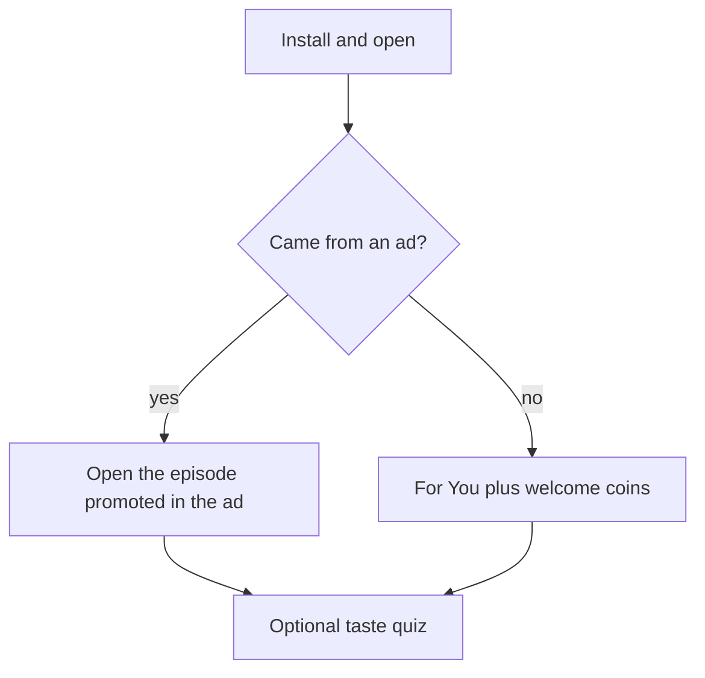

# DramaLama — Product Requirements Document

## 1. Summary

DramaLama is a mobile app for vertical, short-episode drama series (1–3 minutes per episode, 20–100 episodes per series). Viewers swipe through episodes full-screen, the first episodes of every series are free, and the rest unlock with coins, a VIP subscription, or rewarded ads.

Launch market is international, English-first. Content is licensed from existing short-drama producers and distributors.

## 2. Background and problem

### The problem

- Viewers want emotionally gripping stories that fit into a few spare minutes: a commute, a break, or before sleep. Traditional streaming is built for 45-minute episodes on a TV, not for one-handed viewing on a phone.
- Existing short-drama apps solve the format, but most of them feel the same: aggressive paywalls, generic discovery that ignores what the viewer likes, and little reason to come back once a series ends.
- Support in these apps is usually an email form, so payment and unlock problems turn into churn and bad reviews.

### The opportunity

- Vertical short drama is a fast-growing category, led by apps from China-based studios expanding to English-speaking markets. The format has proven that viewers will pay per episode for cliffhanger-driven stories.
- Licensed content is available from existing producers and distributors, so the app can launch without original production.

### Competitors

| App | What it does well | Gap we target |
| --- | --- | --- |
| ReelShort | Strong original catalog and brand, effective paywall placement | Little personalization or reason to stay after a series ends |
| DramaBox | Large catalog, frequent new releases | Generic discovery, coin-heavy monetization |
| ShortMax and similar apps | Fast-follower catalogs and aggressive promotions | Similar experience across apps, weak community and support |

### How DramaLama is different

- **Personalized discovery:** a taste profile drives Home, search, and recommendations from the first session.
- **Reasons to come back:** points, streaks, and missions reward daily viewing and participation.
- **A companion, not a help center:** an in-app character recommends series, answers support questions, and hands off to a human when needed.
- **Community around episodes:** comments on every episode turn cliffhangers into conversations.

## 3. Goals and non-goals

### Goals

- Make the first episode start within 2 seconds of opening a series or the For You feed.
- Keep viewers watching through a series with auto-advance, cliffhanger paywalls, and resume-anywhere.
- Monetize through a hybrid model without blocking discovery.
- Give the content team a self-serve admin to publish licensed series without engineering help.
- Personalize discovery: Home, search, and recommendations adapt to what each viewer likes.
- Extend retention beyond a single series through gamification (points, streaks, missions) and an in-app companion.

### Non-goals (MVP)

- User-generated content or creator uploads (episode comments are the only user-generated content in scope).
- Original productions.
- Social profiles, following, or direct messages between viewers.
- Downloads for offline viewing.
- Languages other than English (the UI must be localization-ready).

## 4. Target users

- **Primary:** 25–45, mostly women, mobile-only viewers who watch in short sessions (commute, breaks, before sleep) and enjoy romance, revenge, CEO, and werewolf tropes.
- **Secondary:** binge viewers who finish a series in one or two sittings and are the main payers.
- Both groups are casual-game friendly: they respond to daily rewards, streaks, and collectibles, which the gamification and companion features build on.

## 5. What exists today (prototype)

Built in Expo SDK 58 with Expo Router:

- Home: rotating hero banner, Continue watching, Trending top 10, New & exclusive, genre grid.
- For You: vertical swipe feed autoplaying episode 1 of each series.
- Player: full-screen vertical episode feed, auto-advance, playback speed, episode picker sheet, like / save / share / comment rail. The Episodes button opens the picker sheet in both the player and For You.
- Series page: stats, tags, expandable synopsis, numbered episode grid with watched and current states.
- Library tab: Continue watching with progress, and My list (saved series).
- Profile tab: customer ID with copy, coin and points balances, VIP status, daily check-in with a 7-day streak, sample missions, and entry points to the store and support. Sign-in, preferences, edit details, and settings are placeholders.
- Store screen: coin packs, VIP plans, and points packs with sample prices. No real purchases yet.
- Episode comments: comment sheet over the playing video, with a profanity filter and points for commenting within a daily cap. Comments are sample data.
- Companion: floating button on Home, Library, and Profile, and a chat with scripted replies for recommendations and common support questions.
- Data: hardcoded catalog and comments, placeholder posters and video. Progress, saves, likes, coins, and points are stored on the device only.

The UI is English and left-to-right. Client-side search and categories (section 6.6) are in place.

**Gap to MVP:** there is no backend, accounts, paywall or locked episodes, real purchases, admin, or push yet, and search runs only on the bundled catalog. Not built yet: the taste quiz and personalization, ad-attributed first open, real support escalation, and server-side validation of coins and points.

## 6. MVP scope

### 6.1 Catalog and backend

- Series, seasons (optional), episodes, genres, tags, badges, and rankings served from an API instead of `data/catalog.ts`.
- Each series has: title, synopsis, poster (2:3), banner (16:9 or 4:5), genre, tags, rating, total episodes, free episode count, per-episode coin price, territories, license window.
- Episodes stream as HLS with multiple bitrates, served via CDN.
- Home rows are configured from the admin: hero, trending, new, genre rows, and editorial collections.
- Availability is enforced by territory and license window on the server.

### 6.2 Accounts

- Guest mode by default: a device account is created silently so viewers can watch free episodes immediately.
- Sign in with Apple, Google, and email to upgrade a guest account without losing progress, coins, or purchases.
- Server-side sync of watch progress, saved list, likes, coin balance, and entitlements across devices.
- Account deletion from inside the app (required by the App Store).

### 6.3 Monetization (hybrid)

- **Free episodes:** the first N episodes of each series are free (default 5–10, set per series).
- **Coins:** viewers unlock individual episodes with coins. Coin packs are sold as consumable in-app purchases. Bonus coins come from first purchase, daily check-in (section 6.11), and promotions.
- **Welcome coins:** new viewers who did not arrive from an ad get a small coin grant on first open, enough to unlock a few episodes beyond the free ones.
- **Points packs:** the store also sells points (section 6.11) as consumable in-app purchases.
- **VIP subscription:** weekly, monthly, and yearly auto-renewing subscriptions that unlock all episodes and remove ads.
- **Rewarded ads:** watch an ad to unlock one episode, with a daily cap.
- **Paywall moment:** when auto-advance reaches a locked episode, a bottom sheet offers unlock with coins, start VIP, or watch an ad. Locked tiles show a lock icon in the episode grid.
- **Auto-unlock setting:** optionally spend coins automatically on the next locked episode.
- All digital purchases go through Apple App Store and Google Play billing. Receipts are validated server-side, and entitlements are granted by the server.
- Restore purchases on both platforms.

### 6.4 Admin (content team)

- Web admin to create and edit series, upload or link episode video, set free episode count and pricing, set territories and license windows, schedule releases, and order home rows.
- Upload pipeline: source file → transcode to HLS renditions → thumbnail → publish.
- Roles: admin, content editor, moderator (comments and users only), read-only.
- License tracking per series: licensor, territories, start and end dates, revenue share notes.

### 6.5 Push notifications

- New episodes for saved series.
- Continue watching reminder for an unfinished series.
- Daily check-in and promotional campaigns sent from the admin with segmenting (all, payers, lapsed).
- Opt-in prompt only after the viewer has finished at least one episode.

### 6.6 Search and categories

**Search**

- Entry points: a search bar in the Home header, the search button on category pages, and tapping a tag on a series page.
- Matches title, tags, genre, tagline, and synopsis. Ranking: title prefix, then title, tag, genre, and description, with ties broken by views. Multi-word queries must match every word.
- Ignores punctuation and apostrophes (for example, "CEO's" matches "CEO"). Server-side search adds typo tolerance (for example, "werwolf" finds "werewolf"). Synonyms come later.
- Results show poster, title, genre, episode count, views, tagline, and tags, with genre filter chips when results span more than one genre.
- Empty state shows recent searches (last 8, removable one by one or all at once), popular searches managed from the admin, and the category grid.
- No-results state suggests popular searches.
- Analytics: `search` with the query, result count, and the series tapped.

**Categories**

- Two kinds: **genres** (Romance, Drama, Thriller, Revenge, Fantasy, Comedy) and **editorial collections** (Hot now, New & exclusive, One-evening binge up to 24 episodes, Long sagas with 45+ episodes).
- Each category has a name, a short description, an accent color, a cover from its top series, and a series count. Empty categories are hidden.
- Category page: header, sort by popular, top rated, or shortest, a three-column grid, and links to other categories.
- Home shows a horizontal categories row. The series page links its genre to the genre category.
- In the backend, collections are rule-based (badge, episode count, release date) or hand-picked in the admin, and can be scheduled and targeted by territory.

### 6.7 Player and discovery (keep and extend)

- Keep the existing vertical player, For You feed, auto-advance, speed control, and episode picker.
- Add a locked state, a paywall sheet, and an "unlocked" confirmation.
- Add subtitles (English required, more later) and a mute toggle in the feed.
- Add a comment button with a count to the action rail (section 6.10).
- The Episodes button opens the episode picker sheet from every episode, in both For You and the player.
- Prefetch the next episode, and lower bitrate on poor connections.

### 6.8 Profile tab

A fourth tab, after Home, For You, and Library.

- **My wallet:** coin balance, points balance, VIP status and renewal date, and a transaction history (purchases, unlocks, points earned and spent).
- **Store:** coin packs, VIP plans, and points packs (see section 6.11), with first-purchase bonuses highlighted.
- **Rewards and participation:** daily check-in (coins) with the current streak, active missions with progress (points), and points history.
- **Customer ID:** a short, human-readable ID shown in the profile with a copy button, used by support and the companion.
- **Edit details:** name, email, avatar photo, and linked sign-in methods (Apple, Google, email). Guests see a prompt to create an account.
- **Settings:** auto-unlock with coins, notifications, language, mature-content filter, privacy and data consent, restore purchases, sign out, and delete account.
- **Support:** opens the companion in support mode, plus FAQ, terms, and privacy policy.
- **My preferences:** the taste quiz (section 6.9) with editable answers: favorite genres and tropes, disliked themes, preferred episode length, and watch times.

### 6.9 Personalization and data

- **Taste profile:** built per viewer from the taste quiz, likes, saves, completed series, drop-off points, searches, and the tags of watched series. It updates continuously as the viewer watches.
- **Taste quiz:** a short, skippable quiz (about 5 questions, with posters and tropes to pick from). It is offered after the first episode and available any time from Profile. Completing it earns points.
- **Home:** a "Recommended for you" row based on the taste profile, and other rows reordered by relevance. New viewers without history get trending content until there is enough signal.
- **Search:** text match stays the main ranking signal, with a taste boost that lifts series matching the viewer's profile. The empty state adds "Because you liked ..." suggestions.
- **Filtering by tags:** search results and category pages can be filtered by tags (for example: CEO, revenge, second chance, werewolf), not only by genre.
- **Data collection:** all viewing, engagement, search, and quiz events (section 10) feed the taste profile and the analytics warehouse. Collection follows the consent rules in section 11.

### 6.10 Episode comments

- A comment button with a count in the right-side action rail in both For You and the player.
- Opens a bottom sheet over the playing video: comment list (top and newest), a composer, like, reply (one level), and report.
- Comments belong to an episode, and the series page shows the total count.
- Requires an account or a guest display name. A profanity filter runs before posting.
- Viewers can block another user, and then no longer see that user's comments.
- Moderation in the admin: report queue, hide or delete comments, and mute or ban users.

### 6.11 Gamification and points

- **Points** are a reward currency, separate from the coins used to unlock episodes.
- **Daily check-in:** once a day the viewer checks in and receives bonus coins, with a larger bonus on streak milestones (for example, day 7). Check-in coins are bonus coins (section 6.3), so they help viewers unlock episodes and build the habit of coming back.
- **Ways to earn points:** posting comments, likes and shares, completing the taste quiz and preferences, and missions or weekly challenges (for example, "finish 3 episodes today" or "start a new series this week").
- **Buying points:** points packs are sold in the store as consumable in-app purchases.
- **Ways to spend:** companion skins and accessories (section 6.12, later phase), and other in-app rewards.
- **Anti-abuse:** daily caps per action, no points for deleted or reported comments, server-side validation of every grant, and welcome and check-in coins limited per device so that new guest accounts cannot be used to farm coins.
- Missions, rewards, and caps are configurable from the admin.

### 6.12 Companion (basic)

- A floating circle button available on main screens (not over the full-screen player), showing the companion character.
- Tapping it opens a chat with the character, which:
  - Recommends series based on the taste profile and the conversation.
  - Answers support questions (billing, unlocks, account, playback) and can look up the viewer's wallet and purchase history.
  - Escalates to a human support agent when it cannot resolve an issue, attaching the customer ID and the conversation (the companion handles Tier 1, humans handle higher tiers).
- Built by integrating an existing conversational or support platform rather than built from scratch.
- Safety: stays in character, avoids off-topic or unsafe content, and never makes purchases without explicit confirmation.
- **Later phase:** an avatar editor to customize the companion, and a skins economy where skins are bought with points to drive longer retention.

## 7. Key flows

1. **First open:** a guest account is created silently, then the app checks install attribution.
   - **From an ad:** the app opens straight into the series and episode promoted in that ad (deferred deep link).
   - **Organic:** For You autoplays and the viewer receives welcome coins.
   - In both cases, after the first episode the viewer is offered the optional taste quiz.

2. **Paywall:** free episodes end → paywall sheet → coins, VIP, or ad → playback continues with no extra taps.
3. **Return visit:** push or app open → Continue watching → resumes at the saved second.
4. **Upgrade account:** prompt after first purchase or on a second device → sign in → everything syncs.
5. **Publish:** content editor uploads a series → transcoding → schedule → goes live in the selected territories.
6. **Taste quiz:** prompt after the first episode, or Profile → My preferences → pick genres, tropes, and posters → points awarded → Home and search update.
7. **Daily rewards:** daily check-in → bonus coins added with a short celebration → wallet updated. Mission complete → points added → spend on rewards (skins in a later phase).
8. **Comment:** comment button in For You or the player → sheet opens over the playing video → post, like, or reply → points awarded within the daily cap.
9. **Companion support:** tap the companion → ask a question → the companion answers or looks up the wallet → if unresolved, it escalates to a human with the customer ID and transcript → the viewer is notified when an agent replies.

## 8. User stories and use cases

### 8.1 User stories

Each story follows the format "As a [user], I want [goal], so that [reason]", followed by acceptance criteria that define when it is done.

**Discovery and playback**

**US-01 · Watch without signing up**
As a new viewer, I want to start watching right away without creating an account, so that I can decide if I like the app before committing.
- A guest account is created silently on first open.
- The first frame plays within 2 seconds at p75.
- No sign-up prompt appears before the first episode ends.

**US-02 · See all episodes from any episode**
As a viewer, I want to open the full episode list from the episode I'm watching, so that I can jump ahead or go back.
- The Episodes button opens the episode picker sheet in both For You and the player.
- Watched, current, and locked episodes are visually distinct.
- Tapping an unlocked episode plays it. Tapping a locked episode opens the paywall sheet.

**US-03 · Resume where I stopped**
As a returning viewer, I want to continue a series from the exact second I stopped, so that I don't have to search for my place.
- Library → Continue watching lists unfinished series, most recent first.
- Playback resumes at the saved second.
- After sign-in, progress is the same on every device.

**Monetization**

**US-04 · Unlock the next episode without leaving the story**
As a viewer who reached a locked episode, I want to unlock it from inside the player, so that the cliffhanger isn't interrupted.
- The paywall sheet opens automatically when auto-advance reaches a locked episode.
- It offers coins, VIP, and a rewarded ad (when the daily cap allows).
- After a successful unlock, playback starts without extra taps.
- If the payment fails or is cancelled, the sheet stays open with a clear message.

**US-05 · Welcome coins for new organic viewers**
As a new viewer who found the app on my own, I want a few free coins, so that I can try more episodes before paying.
- Granted once per account on first open, only for installs not attributed to an ad.
- A short message explains the gift and the new balance.

**Profile**

**US-06 · Wallet in one place**
As a viewer, I want to see my coins, points, VIP status, and history in one screen, so that I know what I have and what I spent.
- Profile → My wallet shows coin balance, points balance, and VIP status with renewal date.
- Transaction history is sorted newest first and includes purchases, unlocks, and points.

**US-07 · Customer ID for support**
As a viewer with a problem, I want to copy my customer ID, so that support can find my account quickly.
- The customer ID is visible in Profile with a copy button.
- The same ID is attached automatically when the companion escalates to a human.

**US-08 · Manage my account**
As a viewer, I want to update my details and settings, so that the app works the way I want.
- I can edit name, email, and photo, and link Apple, Google, or email sign-in.
- Settings include auto-unlock, notifications, mature filter, data consent, restore purchases, sign out, and delete account.
- Account deletion works fully inside the app.

**Personalization**

**US-09 · Tell the app what I like**
As a viewer, I want to answer a short quiz about my taste, so that recommendations fit me from the start.
- The quiz has about 5 questions and can be skipped.
- It is offered after the first episode and available any time from Profile → My preferences.
- Answers can be edited later. Points are awarded once, on first completion.

**US-10 · Home recommends series I'll like**
As a viewer, I want Home to show series that match my taste, so that I find my next binge quickly.
- A "Recommended for you" row appears after the quiz or after enough likes and completions.
- Series the viewer already finished are excluded.
- Viewers without enough signal see trending content instead.

**US-11 · Search that knows my taste**
As a viewer, I want search results to consider what I like, so that the most relevant series show first.
- Series that match the query always rank above series that don't.
- Among similar text matches, series matching the taste profile rank higher.

**US-12 · Filter by tags**
As a viewer, I want to filter by tags like "CEO" or "revenge", so that I find exactly the trope I'm in the mood for.
- Tag chips appear on search results and category pages.
- Several tags can be selected together, and one action clears all filters.

**Comments**

**US-13 · Comment without stopping the episode**
As a viewer, I want to comment on an episode while it plays, so that I can react to the cliffhanger in the moment.
- The comment sheet opens over the playing video.
- A new comment appears immediately after posting, and the count updates.
- Comments with profanity are blocked with a clear message.

**US-14 · Report an offensive comment**
As a viewer, I want to report an offensive comment, so that the community stays pleasant.
- Every comment has a report action.
- A reported comment is hidden for the reporter right away and enters the admin queue.
- I can also block the author, so I no longer see any of their comments.

**Gamification**

**US-15 · Daily check-in**
As a returning viewer, I want a reward for opening the app every day, so that I have a reason to come back.
- Check-in is available once per calendar day in the viewer's time zone.
- Each check-in grants bonus coins, and the coin balance updates right away.
- The streak resets after a missed day. Milestone days give extra coins.

**US-16 · Missions**
As a viewer, I want missions with clear goals and rewards, so that watching feels like a game.
- Active missions show progress (for example, 2 of 3 episodes).
- The reward is granted automatically on completion, with a short celebration.
- Missions are configured from the admin.

**US-17 · Buy points**
As a viewer who wants rewards faster, I want to buy points, so that I can get what I want without waiting.
- Points packs are listed in the store and bought through App Store or Google Play.
- The balance updates only after the server validates the receipt.

**Companion**

**US-18 · Ask the companion what to watch**
As a viewer, I want to ask the companion for a recommendation, so that I get a personal suggestion like from a friend.
- The companion replies with 1–3 series shown as tappable cards.
- Suggestions are based on the taste profile and what was said in the chat.

**US-19 · Get help from the companion, and a human if needed**
As a viewer with a billing or playback problem, I want to get help inside the app, so that I don't have to send emails.
- The companion can see the viewer's wallet and purchase history.
- If it cannot solve the issue, it escalates to a human with the customer ID and the transcript.
- The viewer is notified when a human agent replies.

**Admin**

**US-20 · Publish a series**
As a content editor, I want to publish a licensed series on my own, so that I don't depend on engineering.
- I can upload episodes, set the free episode count, price, territories, and release date.
- The series goes live automatically at the scheduled time, only in the selected territories.

**US-21 · Moderate comments**
As a moderator, I want to handle reported comments, so that the community stays safe and the app meets store rules.
- The report queue shows the comment, its episode, and the reporter count.
- I can hide or delete comments, and mute or ban users.
- Reports are handled within 24 hours.

### 8.2 Use cases (critical flows)

**UC-1 · First open from an ad**

| Field | Details |
| --- | --- |
| Actor | New viewer who tapped an ad for a specific series |
| Goal | Watch the episode promoted in the ad, immediately |
| Preconditions | App not installed. The ad carries a campaign and target episode. |
| Trigger | The viewer installs and opens the app for the first time. |
| Related | US-01, sections 6.2, 6.3, 7 |

Main flow:
1. The app creates a guest account in the background.
2. The app reads the install attribution and finds the target series and episode.
3. The player opens directly on that episode and starts playing.
4. The `install_attributed` event is sent with the campaign and episode.
5. After the episode ends, the app offers the optional taste quiz.

Alternate flows:
- **2a. No attribution found:** the app treats the install as organic, opens For You, and grants welcome coins.
- **3a. Target episode is unavailable in the viewer's territory:** the app opens the series page, or For You if the series is unavailable.
- **3b. Target episode is locked:** the paywall sheet opens on top of the episode.

Postconditions: the viewer is watching the promoted content, and the install is attributed to the campaign.

**UC-2 · Unlock a locked episode**

| Field | Details |
| --- | --- |
| Actor | Viewer watching a series |
| Goal | Continue to the next episode after the free ones end |
| Preconditions | The next episode is locked, and the viewer is not VIP. |
| Trigger | Auto-advance reaches a locked episode, or the viewer taps a locked episode. |
| Related | US-04, section 6.3 |

Main flow:
1. The paywall sheet opens with the episode price, the viewer's coin balance, VIP plans, and a rewarded ad option.
2. The viewer chooses to unlock with coins.
3. The server checks the balance, deducts the coins, and grants the entitlement.
4. The sheet shows an "unlocked" confirmation and playback starts.

Alternate flows:
- **2a. Not enough coins:** the sheet shows coin packs. After a successful purchase, the flow continues at step 3.
- **2b. VIP:** the viewer subscribes through the store. After validation, all episodes unlock and playback starts.
- **2c. Rewarded ad:** the viewer watches an ad to the end, then the episode unlocks. If the daily cap is reached, the option is hidden.
- **2d. Auto-unlock is on:** steps 1–2 are skipped when the balance is enough.
- **3a. Purchase fails or is cancelled:** the sheet stays open with a message, and nothing is charged.

Postconditions: the episode is unlocked on all the viewer's devices, and `unlock_coins`, `unlock_ad`, or `subscription_start` is sent.

**UC-3 · Complete the taste quiz**

| Field | Details |
| --- | --- |
| Actor | Viewer |
| Goal | Get recommendations that fit their taste |
| Preconditions | The viewer finished at least one episode, or opened Profile → My preferences. |
| Trigger | The quiz prompt appears, or the viewer opens it from Profile. |
| Related | US-09, US-10, US-11, section 6.9 |

Main flow:
1. The app shows about 5 questions with posters and tropes to pick from.
2. The viewer answers all questions.
3. The answers are saved to the taste profile.
4. The viewer receives points with a short celebration (first completion only).
5. Home shows a "Recommended for you" row, and search uses the new profile.

Alternate flows:
- **1a. The viewer skips:** the app does not ask again in the same session, and the quiz stays available from Profile.
- **2a. The viewer leaves halfway:** the answers given so far are saved, and no points are awarded.

Postconditions: the taste profile is updated, and `quiz_complete` and `points_earn` are sent.

**UC-4 · Get support through the companion**

| Field | Details |
| --- | --- |
| Actor | Viewer with a problem, companion, human support agent |
| Goal | Resolve a billing, unlock, account, or playback issue inside the app |
| Preconditions | The viewer has a customer ID (guest or signed in). |
| Trigger | The viewer taps the companion button, or Profile → Support. |
| Related | US-07, US-19, section 6.12 |

Main flow:
1. The companion chat opens in support mode.
2. The viewer describes the problem (for example, "I paid but the episode is still locked").
3. The companion checks the wallet and purchase history.
4. The companion explains what happened and fixes it if it is allowed to (for example, triggers a restore purchases).
5. The viewer confirms the issue is resolved.

Alternate flows:
- **4a. The companion cannot resolve the issue:** it escalates to a human agent with the customer ID and transcript, and tells the viewer what to expect.
- **4b. A human agent replies:** the viewer gets a notification and continues the conversation in the same chat.
- **2a. The request is off-topic or unsafe:** the companion declines politely and stays in character.

Postconditions: the issue is resolved or assigned to a human, and `companion_open`, `companion_message`, and, if needed, `support_escalation` are sent.

**UC-5 · Daily check-in and mission reward**

| Field | Details |
| --- | --- |
| Actor | Returning viewer |
| Goal | Collect daily rewards and mission rewards |
| Preconditions | The viewer has not checked in today. |
| Trigger | The viewer opens the app, or Profile → Rewards and participation. |
| Related | US-15, US-16, section 6.11 |

Main flow:
1. The app shows the daily check-in card with the current streak.
2. The viewer taps check-in.
3. The server grants the bonus coins and updates the streak.
4. The app shows a short celebration and the new balance.
5. Later in the session, the viewer finishes a mission (for example, 3 episodes), and the reward is granted automatically.

Alternate flows:
- **3a. The viewer missed yesterday:** the streak restarts at day 1.
- **3b. Milestone day (for example, day 7):** extra bonus coins are added.
- **5a. A daily cap is reached:** the action still works, but no more points are granted, and the app says so.

Postconditions: coins, points, and streak are updated on the server, and `checkin` (with the coins granted), `points_earn`, and `mission_complete` are sent.

## 9. Success metrics

| Metric | MVP target |
| --- | --- |
| Time to first frame | < 2 s at p75 |
| Day-1 retention | ≥ 35% |
| Day-7 retention | ≥ 15% |
| Episodes per session | ≥ 8 |
| Paywall view → unlock or purchase | ≥ 8% |
| Payer conversion (30 days) | ≥ 3% |
| Playback errors | < 1% of starts |
| Day-30 retention | ≥ 7% |
| Taste quiz completion (of viewers offered it) | ≥ 40% |
| Comments per 100 episode views | ≥ 1 |
| Viewers with a 3+ day check-in streak (of weekly actives) | ≥ 20% |
| Companion sessions per daily active user | ≥ 0.3 |
| Support issues resolved by the companion without a human | ≥ 60% |

The targets are initial guesses, to be revisited after the first 4 weeks of data.

## 10. Analytics events

`app_open`, `feed_view`, `series_view`, `episode_start`, `episode_complete`, `episode_drop` (with second), `paywall_view`, `unlock_coins`, `unlock_ad`, `purchase_start`, `purchase_success`, `subscription_start`, `subscription_renew`, `subscription_cancel`, `search`, `push_open`, `save`, `like`, `share`.

Added in v0.2: `install_attributed` (with campaign and target episode), `quiz_complete`, `preferences_update`, `comment_post`, `comment_like`, `comment_report`, `points_earn` (with source), `points_spend`, `mission_complete`, `checkin`, `store_view`, `companion_open`, `companion_message`, `support_escalation`.

## 11. Non-functional requirements

- Platforms: iOS 17+ and Android 10+. Web is not a launch target.
- Content protection: DRM (FairPlay and Widevine) or at minimum signed, expiring HLS URLs, depending on licensor requirements.
- Performance: 60 fps scrolling in the feed, and a capped number of active video players.
- Accessibility: Dynamic Type, screen reader labels on all controls, captions.
- Localization-ready UI strings, LTR for launch, with RTL support kept for later.
- Privacy: GDPR and CCPA consent, App Tracking Transparency on iOS before any ad tracking, age gate 13+ (or 17+ depending on content ratings).
- Personalization data: viewers can see and reset their taste profile, and opt out of personalized recommendations in settings. Install attribution respects App Tracking Transparency.
- Comments: report, block, and moderation tools are required by App Store and Google Play rules for user-generated content. Reported comments are reviewed within 24 hours.
- Companion: conversations are logged for support and safety review, filtered for unsafe content, and never trigger a purchase without explicit confirmation. Personal data shared with the integrated platform is limited to what support needs.

## 12. Legal and licensing

- Every series has a signed license covering territories, the window, and whether ads and paid unlocks are allowed.
- Credits and licensor attribution shown on the series page if the contract requires it.
- Terms of service, privacy policy, a subscription terms screen, and an auto-renew disclosure per App Store rules.
- Content ratings per series, with a mature-content filter.

## 13. Phasing

| Phase | Scope |
| --- | --- |
| M0 — foundation | Backend and API, guest accounts, catalog from server, server-side search with typo tolerance, HLS playback |
| M1 — monetization | Free episode limit, coins, VIP, paywall sheet, receipt validation, restore, Profile tab (wallet, store, customer ID, settings), episode comments |
| M2 — operations | Admin, upload pipeline, scheduling, territories, comment moderation |
| M3 — growth | Push, personalized search, rewarded ads, daily check-in, analytics dashboards, ad-attributed first open and welcome coins, taste quiz and personalization, points and missions, basic companion (chat, recommendations, support) |
| Launch | Soft launch in 1–2 English-speaking territories, then expand |
| M4 — companion economy | Companion avatar editor, skins bought with points, deeper gamification |

## Appendix A. Glossary

| Term | Meaning |
| --- | --- |
| Series | A short drama made of 20–100 vertical episodes. |
| Episode | A single 1–3 minute part of a series. |
| Free episodes | The first episodes of a series that anyone can watch without paying. |
| Locked episode | An episode that requires coins, VIP, or a rewarded ad to watch. |
| Unlock | Granting a viewer permanent access to a locked episode. |
| Paywall | The bottom sheet that offers ways to unlock a locked episode. |
| Coins | The in-app currency used to unlock episodes. Bought in packs, or received as bonus coins (first purchase, welcome coins, daily check-in, promotions). |
| Points | The reward currency earned through participation (comments, missions, taste quiz) or bought in packs. Used for rewards such as companion skins. |
| VIP | An auto-renewing subscription that unlocks all episodes and removes ads. |
| Rewarded ad | A video ad the viewer chooses to watch in exchange for unlocking an episode. |
| Welcome coins | A one-time coin gift for new viewers who did not arrive from an ad. |
| Auto-advance | Playing the next episode automatically when the current one ends. |
| Auto-unlock | A setting that spends coins on the next locked episode without asking. |
| For You | The vertical swipe feed that autoplays the first episode of different series. |
| Genre | A broad content type, such as Romance or Thriller. |
| Tag / trope | A specific story theme, such as CEO, revenge, or werewolf. Used for search and filtering. |
| Collection | An editorial group of series, such as "Hot now". Rule-based or hand-picked. |
| Taste profile | What the app knows about a viewer's preferences, built from the quiz and their behavior. |
| Taste quiz | A short questionnaire about the viewer's preferences. |
| Streak | The number of consecutive days the viewer checked in. |
| Daily check-in | A once-a-day action that grants bonus coins and extends the streak. |
| Mission | A goal with a reward, such as "finish 3 episodes today". |
| Companion | An in-app character the viewer chats with for recommendations and support. |
| Skin | A cosmetic look for the companion, bought with points (later phase). |
| Customer ID | A short, unique ID shown in Profile, used to identify the viewer in support. |
| Tier 1 support | First-line support that handles common questions. Harder cases escalate to higher tiers. |
| Escalation | Handing a support conversation from the companion to a human agent. |
| Guest account | An account created automatically on the device, without sign-up. |
| Entitlement | A server record that a viewer has access to an episode or to VIP. |
| Install attribution | Identifying which ad or campaign led to an install. |
| Deferred deep link | A link that opens specific content in the app on first launch, even if the app was installed after the link was tapped. |
| Territory | A country or region where a series is licensed to be shown. |
| License window | The start and end dates during which a series may be shown. |
| HLS | The video streaming format used to deliver episodes at different qualities. |
| DRM | Technology that protects video content from being copied. |
| Admin | The web tool the content and operations team uses to manage the app. |
| MVP | Minimum viable product: the first version that goes to market. |
